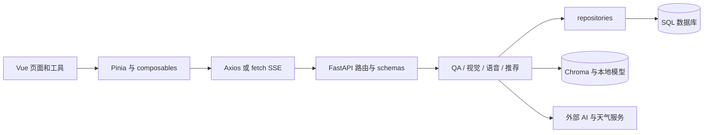

# 架构与业务链路

核验于 2026-11-07，集成分支代码基线 `7ef0459`，另含本轮 K01 前端恢复接入。下文区分自动化/源码证据与真实设备、供应商、部署数据库验收；任务状态及差异见 [HANDOFF](agent-operations/HANDOFF.md)。
> ASR 与视觉接口支持可选 `Idempotency-Key`，按接口、键和请求 fingerprint 做 5 分钟进程内 single-flight 与 JSON 结果缓存；同键不同请求返回 409，超过 128 条/1 MiB 响应上限时拒绝新任务或淘汰过期/最近最少使用结果。不保存上传内容；该能力不跨多 worker 或重启。
> 真实 ASR provider 收到非 WAV 音频时，在占用既有 ASR 容量后通过 [audio_duration](../backend/app/services/audio_duration.py) 用受限 ffprobe 检查系统私有临时文件，校验音轨和时长后才调用 provider；结束后删除临时文件，最长运行时间可配置。该路径需部署系统安装 FFmpeg；游客录音器固定输出 WAV，不依赖它。当前只检查容器探测出的时长，不承诺完整解码验证。
> 生产环境 `APP_ENV=production` 时，管理员默认密码/签名密钥或过短值会阻止应用启动；`/ready` 同步报告配置缺项，不回显秘密。游客 API 仍公开；[CapacityLimiter](../backend/app/services/capacity.py) 只管单进程并发，不是时间窗口速率限制或多实例防刷。
> 聊天 SSE 有心跳、连接/无数据/无进展/总时限与 `done.completion`；中断保留部分文本并停止音频。流式生成、证据、音频和 completion 各有取消/epoch 所有权；详细调用链和回归见 [功能地图](REPO_MAP.md) 与 [测试状态](agent-operations/TEST_STATUS.md)。

当前集成分支包含 K01、W01、V01 与 W02 的主要代码；功能是否完成按相应验收边界而非分支合并判断。
功能入口见 [REPO_MAP.md](REPO_MAP.md)，运行条件见 [DEVELOPMENT.md](DEVELOPMENT.md)。

## 边界

- [main.js](../frontend/src/main.js) 安装 Pinia、Router、Element Plus；[App.vue](../frontend/src/App.vue) 区分游客舞台和后台布局。
- [router/index.js](../frontend/src/router/index.js) 决定实际页面；游客用一个持久舞台，探索/地图/路线/问答由 ChatView 展开。
- [api/router.py](../backend/app/api/router.py) 注册完整 `/api` 前缀；业务服务不直接决定 Web URL。
- [config.py](../backend/app/core/config.py) 是配置事实来源，设置和模型名称可被环境变量覆盖，不固定承诺某个模型版本。
- [models](../backend/app/models/) 定义 SQL 数据，[repositories](../backend/app/repositories/) 访问数据；Chroma 是另一存储层，更新 SQL 不等于更新向量索引。

## 1. 聊天 / RAG / 语音输出

1. [ChatView](../frontend/src/views/tourist/ChatView.vue) 的 `submitQuery` 收集问题、selection、受众和可选视觉/情绪上下文。
2. [chat store](../frontend/src/stores/chat.js) `sendMessage` 先停止旧输出，再建立新的 AbortController 与请求 token；`session_id` 和 `visitor_id` 分别关联会话及跨会话偏好。
3. [chat API](../frontend/src/api/chat.js) 调用 [useSSEStream](../frontend/src/composables/useSSEStream.js) 的 fetch POST；接口为 `POST /api/chat/stream`。
4. [chat.py](../backend/app/api/chat.py) 的 `build_pipeline` 组合 repository、FAQ、RAG、LLM、TTS 与记忆服务。
5. [QAPipeline.stream_chat](../backend/app/services/qa/pipeline.py) 根据问题、缓存、FAQ/检索证据及所选口径产出事件。具体分支以此函数为准，不能假设每个问题必经所有检索和供应商。
6. [StreamEvent.to_sse](../backend/app/services/qa/stream_events.py) 生成 UTF-8 `event:`/`data:` 帧；前端解析分块、消费文字/证据/音频，并驱动 [useAudioPlayer](../frontend/src/composables/useAudioPlayer.js) 和数字人。

历史回答重播走独立 `POST /api/chat/replay`：前端提交 `chat_log_id` 和当前 `session_id`；[ChatLogRepository](../backend/app/repositories/chat_log.py) 联合匹配归属后，API 仅把已保存的 `answer` 交给 TTS factory，不构建 QA pipeline。聊天保存时记录 answer SHA-256 与非秘密 TTS profile；[ReplayAudioCache](../backend/app/services/tts/replay_cache.py) 按内容指纹和完整 profile 复用合成结果，TTL 30 分钟、最多 128 项、编码音频总计不超过 16 MiB，缓存仅在单进程内有效。重播优先使用记录的生成音色；旧记录回退请求音色。前端共享播放器应用当前本机语速，TTS 未配置或音频无法解码时可回退浏览器朗读。语速偏好不跨设备同步；等 W01 定义游客身份与授权后再评估。

修改协议至少联读：服务端 `StreamEvent`、`QAPipeline`、前端 `useSSEStream`、`chat store`、[流式契约测试](../backend/app/tests/test_chat_stream_api.py)。新增事件须确认所有消费者，不能只改服务端名称。

普通 Axios 请求走 [http.js](../frontend/src/api/http.js) 的 bearer 拦截器；流式 fetch 使用自己的请求头，不自动继承 Axios 拦截器。认证策略变更时分别检查。

降级边界：`build_pipeline` 对部分向量/重排初始化异常有 fallback，TTS 可退回 stub；但 [main.py](../backend/main.py) 的 lifespan 会预加载本地模型，不可据此推断“没有模型也一定能启动”。

## 2. 录音和图像输入

- **录音**：[useRecorder](../frontend/src/composables/useRecorder.js) 优先 AudioWorklet，失败尝试 ScriptProcessor，输出 WAV；[voice API](../frontend/src/api/voice.js) 上传原始音频 body 到 `POST /api/asr/transcribe`。默认火山 ASR 通过 WebSocket 分包发送，非 16 kHz 单声道输入由 FFmpeg 转换，不需要把录音文件暴露到公网。显式切换旧 Bailian 文件识别时仍需可公网访问的文件 URL。转写确认后再进入聊天。浏览器 [SpeechRecognition](../frontend/src/composables/useSpeechRecognition.js) 是另一能力通路，存在构造器不代表服务可用。
- **相机/相册**：[useCamera](../frontend/src/composables/useCamera.js) 返回 File，ChatView 或 file input 选择文件；[vision API](../frontend/src/api/vision.js) 以文件 MIME 上传原始 body 到 `POST /api/vision/analyze`，不是 multipart。
- **识别结果到回答**：[vision.py](../backend/app/api/vision.py) 校验 MIME/大小并返回候选景点、文字、检索查询等；ChatView 的 `askFromImage` 把识别结果送入聊天。视觉识别和有证据的最终讲解是两个阶段。
- `.heic`、GIF 等不在当前 JPEG/PNG/WebP 白名单内；不得把“能打开相册”视为所有相册格式都能识别。
- 权限拒绝或设备不支持时使用已有文字输入/文件上传入口；回收 track 和对象 URL 的位置在 composables 与 ChatView 生命周期。

## 3. 定位和自动讲解

[MapView](../frontend/src/views/tourist/MapView.vue) → [useGeolocation](../frontend/src/composables/useGeolocation.js) / [useNarration](../frontend/src/composables/useNarration.js) → [narration API](../frontend/src/api/narration.js) → `POST /api/guide/narration` → [guide.py](../backend/app/api/guide.py)。

讲解接口复用 QA 生成文本，再合成整段音频，以景点/音色/模型缓存并合并并发；不可用时返回 `available=False`，TTS 缺失也可返回文本。触发/排队状态机在 useNarration；请求、静态简介回退和播放编排在 MapView 的 `playNarration`，浏览器朗读在 useAudioPlayer。聊天与地图通过同一个播放器按来源领取播放会话；接管会停止旧来源、忽略迟到音频，并复用游客本机语速偏好。地图讲解也会同步数字人的说话状态；提案停止等待只取消当前浏览器请求/轮询，服务端持久化任务仍可能完成，但不会自动应用或覆盖本地草稿。

定位层包含真实与模拟状态，坐标变换和触发阈值见 [narration 常量](../frontend/src/constants/narration.js)。`useGeolocation` 将浏览器 `latitude/longitude` 映射到应用内部 `lat/lng`；自动讲解目前仅允许已标识的模拟坐标，真实坐标下保留手动讲解。自动化坐标测试不替代真机 GPS 精度、权限与实地验收。

## 4. 管理、数据与资源

- 登录与 token：[auth.py](../backend/app/api/auth.py)、[auth store](../frontend/src/stores/auth.js)。接口是否受保护以具体路由依赖为准，前端路由守卫只是导航控制。
- 知识以稳定 entry ID、不可变 draft/published revision 和持久 job 管理。管理员编辑写草稿；文件进入 `/api/knowledge-imports` 持久批次，经冲突核对后保存为草稿；`/api/knowledge-publications` 固定提交的 revision 并以数据库发布指针决定游客可见性。扫描 PDF 未接 OCR 时进入 `needs_ocr`，不可生成空内容发布。
- 发布准备构建对应 revision 的 chunks/vector，再切换发布可见状态；`VisibilityService` 对直接读取、向量候选和回退检索校验可见版本。发布/下架更新知识 epoch，QA cache 与流式回答通过 epoch 隔离旧结果。全量索引重建使用安全替换路径；应以 [知识地图](REPO_MAP.md) 的专项链路排查，不把旧 `ProcessedDataImporter.sync` 当作后台草稿发布。
- [QACache](../backend/app/services/qa/cache.py) 使用内存及持久化缓存；知识 epoch 进入缓存 key，流式路径在证据、音频/完成与副作用前重新验证。具体缓存、FAQ 与 fallback 分支须结合 [QAPipeline](../backend/app/services/qa/pipeline.py) 和专项测试核对。
- 盲区：QA tracker → [knowledge_blind_spot repository](../backend/app/repositories/knowledge_blind_spot.py) → 管理员 FAQ 解决闭环。
- 背景/欢迎语：[display_assets service](../backend/app/services/display_assets.py) 存储配置和上传资源；公开读取与后台写操作分开，URL 经 [display.js](../frontend/src/api/display.js) 解析。
- 记忆：[visitor_memory repository](../backend/app/repositories/visitor_memory.py) 和 [memory/profile.py](../backend/app/services/memory/profile.py)；浏览器本地标识并不代表跨设备账号同步。

## 5. 游客游览任务（W01）

- 游览任务有独立 `tour_sessions.id`，不复用聊天 `session_id`。任务快照、不可变修订、事件和成果引用写入 SQL；草稿不进入 FAQ/RAG 公共检索。
- 首版匿名身份由 `tour_identity` HttpOnly cookie 提供，服务端仅保存 credential SHA-256 摘要；身份有效期 365 天。CSRF cookie 与身份绑定，写请求同时校验同源 `Origin` 与 token。
- `/api/tour-sessions` 的读取和写入均以匿名身份 owner_id 过滤。管理员 bearer token 不扩大游客任务读取权限。景区 ID 由服务端 `SITE_ID` 配置写入，不接受游客请求覆盖。
- 每次保存创建新 revision；`expected_version` 不匹配返回 409。创建与保存要求幂等键，同键同请求重放原响应，同键不同请求冲突。
- 删除进入 30 天回收站，可恢复；超期由回收站查询时清理。历史版本恢复会产生新 revision。事件接口只读并按所有者隔离。
- 前端以 `RouteView` 的“我的游览”入口创建/查看/删除游览任务，可把当前路线作为行程快照保存。匿名身份不支持跨设备找回；cookie 被禁用时前端提示无法持久化。

## 6. 可编辑行程与连续对话修改（V01，实现中）

- V2 快照在 W01 不可变修订上记录约束、停留点、发布内容引用、锁定字段和未知时长；V1 旧快照需显式升级，legacy 保存不能降级覆盖 V2。
- `/api/itinerary/catalog` 只读 K01 当前已发布景点；保存时服务端重新绑定发布条目/修订。模型只能返回 allowlist 操作，确定性 reducer 校验锁定和目录，提案需游客确认才成为新修订。
- V2 持久化路径从当前发布目录与既有服务端快照重建来源/证据；新或改动的停留时长标为游客输入，未验证路段不接受客户端自报证据。开始游览要求本地草稿已保存，版本 CAS 同时核对任务状态以隔离开始/保存竞争。
- `tour_progress` 与追加式进度事件独立于计划快照，带自己的版本和幂等键；编辑行程时保留 completed/skipped/current 事实并同步未来 pending 点。
- RouteView 可手动编辑约束、景点、休息点、时长和锁定；ChatView 对明确改线语句调用提案接口；MapView 只按当前目录带坐标的已确认点投影。
- 预算把未知停留/路段标为未核实。当前没有权威开放时间、路网或可达性数据；provider 未配置时 AI 提案返回不可用，手动编辑仍可用。
- V01 提案在等待模型前持久化 executing reservation；同键重复请求复用请求状态，冲突 body 拒绝，超过两分钟的悬挂请求在重试时标记失败。前端可停止当前请求/轮询并忽略迟到结果，但不取消已在服务端运行的 provider 任务。
- V01 与 W02 已在当前集成树通过合并 migration 与持久 execution job 关联：提案在模型执行前保留 reservation，worker 在独立进程运行；API 启动不会自动启动 worker。工具输入绑定行程 revision/progress 版本，旧目标会被 fence；结果不确定时需游客显式确认风险后重试。当前 Alembic 单一 head 为 `91a0c5e2f347`；合成 SQLite migration 与自动化覆盖不证明真实部署库兼容或 PostgreSQL 并发。

当前自动化覆盖 repository、身份/CSRF、API 隔离和幂等键；真实浏览器刷新、关闭重开、服务重启与 cookie 禁用行为仍待手动验收。模型与接口索引见 [REPO_MAP.md](REPO_MAP.md)。

## 6. 运行与部署

- `backend/main.py` 启动时执行 Alembic、bootstrap 与模型预热；先备好数据库、处理数据与模型缓存。
- `GET /health` 是进程级响应；`GET /ready` 检查部分数据库/配置条件，两者都不等于完整外部 AI 验收。
- Vite dev server 监听 `0.0.0.0:5173`，代理 `/api` 与 `/ui-assets` 到开发机后端；设置见 [vite.config.js](../frontend/vite.config.js)。
- 构建后的 `frontend/dist` 存在时，FastAPI 在最后挂载 SPA；外部反代需保留 API、上传资源、静态资源、history 路由回退和 SSE 流式传输。
- 生产手机访问需安全上下文。仅开放 Vite LAN 地址不能保证相机、录音和定位可用，见 [多端矩阵](COMPATIBILITY.md)。
