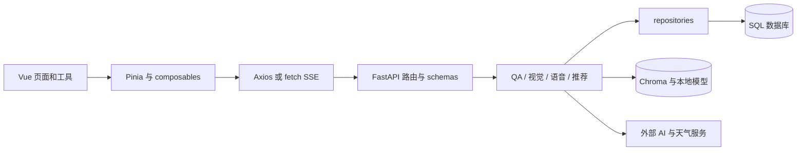

# 架构与业务链路

核验于 2026-10-28，源码基线 `540568e`。这是现有实现的导航，未把路线图中的待办纳入已实现架构。
功能入口见 [REPO_MAP.md](REPO_MAP.md)，运行条件见 [DEVELOPMENT.md](DEVELOPMENT.md)。

## 边界

- [main.js](../frontend/src/main.js) 安装 Pinia、Router、Element Plus；[App.vue](../frontend/src/App.vue) 区分游客舞台和后台布局。
- [router/index.js](../frontend/src/router/index.js) 决定实际页面；游客用一个持久舞台，探索/地图/路线/问答由 ChatView 展开。
- [api/router.py](../backend/app/api/router.py) 注册完整 `/api` 前缀；业务服务不直接决定 Web URL。
- [config.py](../backend/app/core/config.py) 是配置事实来源，设置和模型名称可被环境变量覆盖，不固定承诺某个模型版本。
- [models](../backend/app/models/) 定义 SQL 数据，[repositories](../backend/app/repositories/) 访问数据；Chroma 是另一存储层，更新 SQL 不等于更新向量索引。

## 1. 聊天 / RAG / 语音输出

1. [ChatView](../frontend/src/views/tourist/ChatView.vue) 的 `submitQuery` 收集问题、selection、受众和可选视觉/情绪上下文。
2. [chat store](../frontend/src/stores/chat.js) `sendMessage` 先停止旧输出，再建立新的 AbortController 与请求 token；`session_id` 和 `visitor_id` 分别关联会话及跨会话偏好。
3. [chat API](../frontend/src/api/chat.js) 调用 [useSSEStream](../frontend/src/composables/useSSEStream.js) 的 fetch POST；接口为 `POST /api/chat/stream`。
4. [chat.py](../backend/app/api/chat.py) 的 `build_pipeline` 组合 repository、FAQ、RAG、LLM、TTS 与记忆服务。
5. [QAPipeline.stream_chat](../backend/app/services/qa/pipeline.py) 根据问题、缓存、FAQ/检索证据及所选口径产出事件。具体分支以此函数为准，不能假设每个问题必经所有检索和供应商。
6. [StreamEvent.to_sse](../backend/app/services/qa/stream_events.py) 生成 UTF-8 `event:`/`data:` 帧；前端解析分块、消费文字/证据/音频，并驱动 [useAudioPlayer](../frontend/src/composables/useAudioPlayer.js) 和数字人。

修改协议至少联读：服务端 `StreamEvent`、`QAPipeline`、前端 `useSSEStream`、`chat store`、[流式契约测试](../backend/app/tests/test_chat_stream_api.py)。新增事件须确认所有消费者，不能只改服务端名称。

普通 Axios 请求走 [http.js](../frontend/src/api/http.js) 的 bearer 拦截器；流式 fetch 使用自己的请求头，不自动继承 Axios 拦截器。认证策略变更时分别检查。

降级边界：`build_pipeline` 对部分向量/重排初始化异常有 fallback，TTS 可退回 stub；但 [main.py](../backend/main.py) 的 lifespan 会预加载本地模型，不可据此推断“没有模型也一定能启动”。

## 2. 录音和图像输入

- **录音**：[useRecorder](../frontend/src/composables/useRecorder.js) 优先 AudioWorklet，失败尝试 ScriptProcessor，输出 WAV；[voice API](../frontend/src/api/voice.js) 上传原始音频 body 到 `POST /api/asr/transcribe`。转写确认后再进入聊天。浏览器 [SpeechRecognition](../frontend/src/composables/useSpeechRecognition.js) 是另一能力通路，存在构造器不代表服务可用。
- **相机/相册**：[useCamera](../frontend/src/composables/useCamera.js) 返回 File，ChatView 或 file input 选择文件；[vision API](../frontend/src/api/vision.js) 以文件 MIME 上传原始 body 到 `POST /api/vision/analyze`，不是 multipart。
- **识别结果到回答**：[vision.py](../backend/app/api/vision.py) 校验 MIME/大小并返回候选景点、文字、检索查询等；ChatView 的 `askFromImage` 把识别结果送入聊天。视觉识别和有证据的最终讲解是两个阶段。
- `.heic`、GIF 等不在当前 JPEG/PNG/WebP 白名单内；不得把“能打开相册”视为所有相册格式都能识别。
- 权限拒绝或设备不支持时使用已有文字输入/文件上传入口；回收 track 和对象 URL 的位置在 composables 与 ChatView 生命周期。

## 3. 定位和自动讲解

[MapView](../frontend/src/views/tourist/MapView.vue) → [useGeolocation](../frontend/src/composables/useGeolocation.js) / [useNarration](../frontend/src/composables/useNarration.js) → [narration API](../frontend/src/api/narration.js) → `POST /api/guide/narration` → [guide.py](../backend/app/api/guide.py)。

讲解接口复用 QA 生成文本，再合成整段音频，以景点/音色/模型缓存并合并并发；不可用时返回 `available=False`，TTS 缺失也可返回文本。触发/排队状态机在 useNarration；请求、静态简介回退和播放编排在 MapView 的 `playNarration`，浏览器朗读在 useAudioPlayer。

定位层包含真实与模拟状态，坐标变换和触发阈值见 [narration 常量](../frontend/src/constants/narration.js)。当前 `onSuccess` 直接把 `pos.coords` 传给 `evaluate`，后者读取 `lat/lng`；原生浏览器坐标为 `latitude/longitude`，这是需要修复或通过真实定位回归澄清的静态风险，本次仅建图未改行为。模拟成功不能证明 GPS 链路正常。

## 4. 管理、数据与资源

- 登录与 token：[auth.py](../backend/app/api/auth.py)、[auth store](../frontend/src/stores/auth.js)。接口是否受保护以具体路由依赖为准，前端路由守卫只是导航控制。
- 知识 CRUD：[knowledge API](../backend/app/api/knowledge.py)；导入：[data_import](../backend/app/services/data_import/)；索引：[index_builder](../backend/app/services/rag/index_builder.py)。同步官方数据和重建索引会写入数据，不能作为只读健康检查。
- 数据新鲜度分为 KnowledgeEntry、KnowledgeChunk、Chroma、QA 答案缓存与 FAQ 运行时。当前 CRUD 不自动更新后四层；`ProcessedDataImporter.sync` 以处理数据为输入更新条目/分块并清理持久化答案缓存，管理接口随后重载 FAQ；`build_rag_index` 仅消费既有分块。不要把同步源数据当作后台编辑后的无损发布操作。直接排查入口见 [功能地图](REPO_MAP.md) 的“知识更新后仍返回旧答案”。
- [QACache](../backend/app/services/qa/cache.py) 使用内存及 [持久化缓存](../backend/app/repositories/qa_cache.py)，TTL 在 config 中默认七天；[chat.py](../backend/app/api/chat.py) 的 namespace 没有知识修订号。是否需要失效缓存须核对实际回答分支，不能只重建向量索引。
- 盲区：QA tracker → [knowledge_blind_spot repository](../backend/app/repositories/knowledge_blind_spot.py) → 管理员 FAQ 解决闭环。
- 背景/欢迎语：[display_assets service](../backend/app/services/display_assets.py) 存储配置和上传资源；公开读取与后台写操作分开，URL 经 [display.js](../frontend/src/api/display.js) 解析。
- 记忆：[visitor_memory repository](../backend/app/repositories/visitor_memory.py) 和 [memory/profile.py](../backend/app/services/memory/profile.py)；浏览器本地标识并不代表跨设备账号同步。

## 5. 运行与部署

- `backend/main.py` 启动时执行 Alembic、bootstrap 与模型预热；先备好数据库、处理数据与模型缓存。
- `GET /health` 是进程级响应；`GET /ready` 检查部分数据库/配置条件，两者都不等于完整外部 AI 验收。
- Vite dev server 监听 `0.0.0.0:5173`，代理 `/api` 与 `/ui-assets` 到开发机后端；设置见 [vite.config.js](../frontend/vite.config.js)。
- 构建后的 `frontend/dist` 存在时，FastAPI 在最后挂载 SPA；外部反代需保留 API、上传资源、静态资源、history 路由回退和 SSE 流式传输。
- 生产手机访问需安全上下文。仅开放 Vite LAN 地址不能保证相机、录音和定位可用，见 [多端矩阵](COMPATIBILITY.md)。
