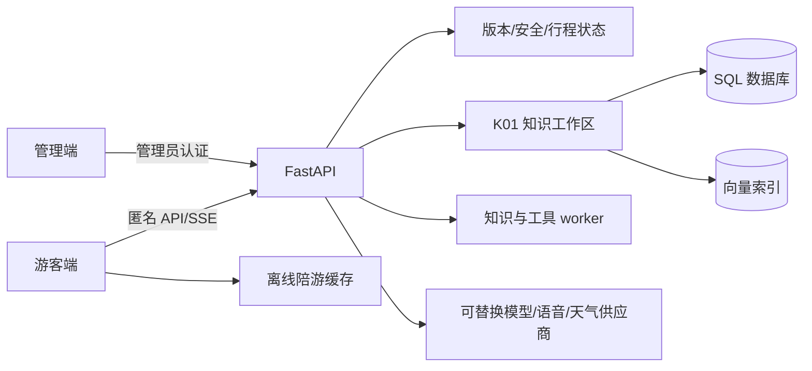

# 技术架构与创新总览

这是当前技术文档的首要入口，把架构、技术组合、技术亮点、创新表述和实现边界放在一起，避免把历史设计、规划能力或模拟演示写成已上线能力。

## 一句话架构

仓库采用游客端与管理端两个独立 Vue/Vite 应用，共用 FastAPI 服务及数据；知识发布和行程提案有各自的后台任务。游客侧已共享部分安全、定位和播放状态，以协调问答、地图、CASS 与行程入口；行程版本及其他状态仍有各自权威来源，尚未形成覆盖全部功能的统一状态。管理侧负责知识、资源、审核、发布和运营观察。

详细事实来源：[ARCHITECTURE](ARCHITECTURE.md)、[REPO_MAP](REPO_MAP.md)、[前端边界](frontend/DESIGN_AND_BOUNDARIES.md)。

## 技术组合

| 技术组合 | 实际落点 | 可核对边界 |
|---|---|---|
| 双端隔离 | `frontend/apps/tourist` 与 `frontend/apps/admin` 独立入口、router、Vite 配置和构建目录 | 共用后端不等于生产 origin、TLS 和代理已验收 |
| 证据约束问答 | FAQ/RAG、已发布 revision、来源和知识 epoch 共同约束回答 | 合成向量和 stub provider 不证明真实回答质量 |
| 请求代际隔离 | SSE、播放器、地图、识景、ASR 和 CASS 调度的部分路径使用请求代次、会话或取消保护 | 覆盖范围须结合各专项测试；真机音频焦点、后台恢复仍需实测 |
| 双通道导览 | 普通讲解/行程建议通道与 CASS 安全规则通道分离，由共享状态仲裁 | 模拟预警不等于现场接警系统 |
| 人在回路 | CASS 或模型只生成可审阅提案，游客确认后才保存行程 | 不自动修改游客已确认成果 |
| 持久化工作流 | 知识发布和行程提案由持久 job、幂等键和版本检查保护 | 真实多实例部署和目标数据库仍待验收 |
| 离线陪游 | 游客侧预缓存离线页及静态资料，网络恢复后提示返回 | 地图与求助资料须核验；Playwright 模拟断网不替代真机蜂窝网络 |

## 可对外表达的技术亮点

1. 面向现场弱网的可中止流式导览：区分连接存活、业务进展、总时限和完成状态，保留部分结果并允许人工重试。
2. 多来源请求代际隔离：通过请求代次、取消和播放会话保护已覆盖路径，减少停止、切换或新请求后的旧结果干扰；具体覆盖以专项测试为准。
3. 知识版本与回答生命周期绑定：草稿不可见，发布 revision 可追溯，知识 epoch 变化会阻止旧证据继续定稿。
4. 安全规则优先于普通生成：CASS 预警可暂停普通讲解及新提案入口；已入队的后台任务不会因此自动取消。模拟预警确认后需显式恢复；真实预警尚无可靠解除契约，不能宣称完整恢复闭环。
5. 游客确认驱动的行程工作流：模型或规则只生成差异可核对的提案，确认前不改变行程，重复确认不重复保存。
6. 离线陪游的可解释降级：离线资源、地图和求助资料明确标注核验边界，恢复网络后不自动跳转或伪造在线状态。

## 必须保留的设计思想

- 事实来源和生成语言分离；模型不能凭景点名称臆造室内外、开放状态或安全结论。
- 规则通道和模型通道分离；安全中断、版本检查和权限边界不能由模型自行决定。
- 游客状态有明确权威来源；安全、定位、播放、行程和目录摘要不能在各组件内各自维护一份。
- 所有“创新”都必须对应代码、测试和适用边界，不使用未经证据支持的行业首创或真实安全保障表述。
- GuideMatch 训练包已入库；候选权重保存在本地 Git 忽略缓存，不随 GitHub 克隆提供。现有模型已在 development/test 下受控接入 FAQ 和 GuideLoop 的非精确匹配；模型不可用时保守回退。用户确认采用现有模型，但本次未复现完整训练，真实游客独立评测、许可证与生产运行仍待验证，详见[训练与接入记录](integration/GUIDEMATCH_TRAINING.md)。

## 设计时的核心表述

项目的场景目标是从被动回答扩展到连续伴游：根据游客时间、偏好和有来源的环境信息调整讲解，同时将安全提示交给独立规则通道。可以将其表述为“基于情境感知与双通道事件驱动架构的自适应导览信息流”；这是成熟技术面向景区场景的组合与工程适配，不宣称发明底层算法。位置、天气、客流的来源、时效、精度和模拟属性需要区分；真实客流、危险围栏、后台接警与自动救援不属于已验收能力。

视觉识别提供候选线索，游客确认与已发布景点版本限定后续检索；图片识别、资料发布和答案引用都不能单独证明事实正确。连续行程应保留原需求、提案差异及游客确认，过期或不确定的任务不能静默覆盖新状态；外部调用结果不确定时，重试可能重复计费。

## 技术文书可用的设计表述

面向景区游览过程中游客需求、空间位置与环境状态持续变化，以及传统导览服务响应被动、信息分散、场景适应不足的问题，本项目设计了一种基于情境感知与双通道事件驱动架构的自适应导览信息流。

该信息流将游客位置、环境状态、游览偏好和行程进度转化为统一的情境信息，以情境变化驱动服务决策，结合检索增强生成与工具调用，动态组织讲解内容、播报时机和行程建议；同时，通过独立的确定性规则通道完成信息有效性校验、安全提示与优先级控制，协调数字人、语音、地图和行程的响应。

由此形成“情境感知—信息融合—服务决策—多端呈现—反馈更新”的连续服务闭环，旨在提高现场导览的情境适配性、服务连续性与交互自然度。以上为设计目标；实际接入范围与实证见[验收总表](testing/TESTING_AND_ACCEPTANCE.md)，不能据此宣称效果提升或现场安全保障。

技术文书可按三层组织：多源情境融合（来源、时间、有效性）、生成式服务与确定性约束协同（内容与优先级）、跨数字人/语音/地图/行程的连续交付。游客停止、偏好变更、离开景点与确认行程是反馈；确认前不改已保存行程。完整设计和远期设想见 [CASS 设计案](讨论优化/CASS-Guide-Development-Plan.md)。

## 已确认的知识与游览产品方向

管理员上传、重新导入与单条编辑统一进入持久草稿工作区：发布前人工核对与解决冲突；发布失败保留旧版和草稿，发布固定当时选中的版本，期间后续编辑不应被覆盖。下架后的资料不能继续作为有效知识；解析失败不能静默删除缺失章节。这些是用户确认的设计要求，各文件格式与真实环境仍按专项验收核实。

游客选择“可验证的局部改线”：表单和自然语言围绕同一行程，保留手动修改、锁定项、已游事实与恢复能力；模型提出修改，程序检查并展示差异，游客确认后保存。未知路程、开放时间及预算不能当作已核实；不以模型自己生成的清单证明完整满足用户原话。详见 [行程设计依据](superpowers/specs/2026-10-29-v01-editable-itinerary-design.md) 和[知识工作区设计依据](superpowers/specs/2026-10-27-knowledge-workspace-design.md)，其中细节须与当前代码和验收记录核对。

### 用户需求与实现范围的追溯

用户要求游客端和运营端共同形成任务闭环：游客侧围绕规划、执行和记录，运营侧围绕资料、讲解、审核发布与反馈；两侧通过已发布内容连接，私人行程不因此向运营公开。此前的 14 项需求覆盖总结导出、美图、识景、并发、防御性设计、社区、文件解析与 OCR、架构调整、多端、弱网、定位/客流/安全、求助、情绪及语速重播，逐项原始编号与工作包映射保留在[需求追溯表](plans/2026-10-28-ai-workbench-backlog.md)。该表保留需求，不代表 14 项均已实现或验收；各功能以[代码地图](REPO_MAP.md)及[验收总表](testing/TESTING_AND_ACCEPTANCE.md)为准。

用户提出组件共享统一状态，工程上应统一权威来源与读取协议：服务端行程版本、播放器会话、安全暂停和定位视图各自拥有明确责任，组件通过 store、动作或服务端接口协作，不能把不同生命周期的所有数据复制为一个无边界对象。当前已接入和仍有缺口的部分见[共享状态盘点](integration/GUIDE_STATE_INVENTORY.md)。

### 用户确定的后续内容生产方向

用户提出双端工作台应支持任务持续、成果可编辑、来源可追溯与失败可恢复。知识导入优先评估 DOCX、XLSX、PPTX、TXT、Markdown 及 PDF/JSON，解析后进入草稿并由人工纠错发布；复杂格式、OCR 和旧版 Office 的具体支持以[知识理解记录](integration/KNOWLEDGE_UNDERSTANDING.md)为准，目标不等于已全部实现。

成果总结的设计目标是由游客选择实际游览内容及讲解或聊天内容，形成可编辑草稿，并区分已游事实与仅讨论内容；基础图片编辑、景区相框与贴纸，以及主动下载、版本和清理管理属于后续方向。当前离线陪游的实际能力与这些设想并不完全相同，见[离线记录](integration/OFFLINE_COMPANION.md)。可供文书讨论的方向是“来源与版本驱动的双端 AI 内容生产闭环”，其导出与效果指标尚需实现和验证，详细来源及设计边界见[第三阶段决策记录](workspace-materials/docs/2026-10-29-phase3-preparation.md)。

### 多源知识加工的原始方案与边界

早期知识工作树提出“AI 全过程深度接入的全链路知识管理体系”，设计闭环为：多源采集 → 智能解析 → 辅助理解 → 人工审核 → 版本化发布 → 证据驱动讲解 → 盲区反馈与补料。其重点是同一景点的多份资料分别保留原件、位置与版本，再供分众讲解使用；模型只提出候选，管理员负责事实审核，程序负责权限、版本和发布。该名称及完整闭环是设计目标，不能写成全部已交付。

原设计还考虑文稿、表格、扫描页、展牌照片、网页和录音等不同资料的解析，以及基于可定位原文生成候选知识卡片。MinerU、PaddleOCR、网页抓取和录音导入等是当时的候选方案，不能因为方案列出就称已接入。现有 DOCX/XLSX、可选本地 PDF OCR 和单草稿理解预览的具体范围，以[知识整合记录](integration/KNOWLEDGE_UNDERSTANDING.md)为准。保留的[原始总方案](research/2026-11-07-ai-knowledge-management-final-design.md)、[讲解融合分析](research/2026-11-07-k02-deepseek-narration-integration.md)和[场景与来源调研](research/2026-11-07-k02-source-research.md)可供后续创作追溯。

### 分众讲解与记忆的设计原则

讲解方式可按儿童、休闲和深度等受众调整表达与信息密度，但不得为简化叙述改变事实、年代或名称；游客偏好和历史行为不能充当景区事实依据。早期方案希望复访时延续讲解，并提供清除能力、区分景区范围及避免个性化答案进入共享缓存；匿名标识不能单独证明身份或保证跨游客隔离，跨会话私有记忆及生产隐私边界须以当前实现和专项验收为准。相关后续设计见 [GuideLoop 记忆研究](reports/2026-11-10-guide-memory-research.md)。

## GuideLoop 的知识演化与记忆设想

当前受控试点将游客问题作为运营观察，管理员核对来源、审核发布并复测；游客路径只在开发/测试开关下读取符合当前已发布知识版本的案例。引用有效或人工勾选不等于事实自动核验，真实资料、多进程与独立评测仍待完成，详见 [GuideLoop 记录](integration/GUIDELOOP_PILOT.md)。

后续记忆设计将景区公共事实、脱敏运营经验、游客私有偏好和当前会话分层，并设想对私有记忆先核验身份、景区和同意再读取；事实有效时间、记录时间与撤回应分别处理。此分层及跨会话私有记忆是研究方向，不代表已完成多租户隔离或真实游客验证。原研究的候选指标和参考文献见[场景记忆调研](reports/2026-11-10-guide-memory-research.md)。

## 连续讲解体验的来源设计

用户提出的方向是让导游区分已展示、已完整播放与未确认接触的内容，并在多景点、追问和重访中保持自然衔接；景点事实必须有来源，不把游客可能的观察或感受编造成经历。原试点的不同生成、自检和分句交付方案及方法学来源已整理在[连续讲解设计](research/CONTINUOUS_NARRATION_DESIGN.md)。主线只接入其中部分共享播放与下一站提示，不将原型的整套事实级状态或实验结论作为主线已完成能力。

## 数字人展示与驱动边界

游客舞台使用 Three.js/VRM 数字人并与问答、语音播放状态协同；管理端提供形象预览与配置入口。当前已提交架构记录将口型描述为基于文本拼音的表现，不把它称为音频驱动模型或经过实测的实时唇形同步。新驱动能力应待对应代码合入、资源来源与实际设备验证后再更新此处；具体代码位置见[功能地图](REPO_MAP.md)。

主线跟踪了 `frontend/public/models/` 的四个 VRM 文件及 `frontend/public/motions/` 的动作资源。2026-11-15 读取四个 VRM 内嵌元数据，均标记 `avatarPermission: onlyAuthor`、`commercialUsage: personalNonProfit`、`modification: prohibited` 和 `allowRedistribution: false`；仓库中的[动作与模型说明](../frontend/public/motions/CREDITS.md)也提示不得再分发模型或修改副本。模型目前已存在于推送过的 Git 主线，元数据本身不能判断是否另有授权；对外展示、分享或继续分发前须由资源负责人核对实际权利与许可，未核实前不能将其写成可自由使用的素材。动作资源有各自来源和许可，不能套用模型条款。

## 技术选型与功能约束

采用现有 FAQ、缓存、检索、流式协议与受控任务执行器的增量方案；曾比较 LangGraph 等框架，但尚无同一真实任务链的对照证明其更优，不将选型说成性能优势。详见[框架研究](architecture/FRAMEWORK_RESEARCH.md)。

行程以版本化快照保存必去、排除和时间约束；缺失路段、时长或未解析名称须标记未核实。提案需同时展示原始需求与差异，用户确认后才生成新版本；模型推断出的操作清单不能证明完整覆盖用户要求。浏览器语音识别及部分转写可能直接提交，启发式低置信转写需确认；语音和视觉效果均受实际供应商与设备限制。更完整的功能与证据见[技术草稿](competition/TECHNICAL_DRAFT.md)。

## 技术文书证据索引

编写或答辩时，从对应代码和验证记录取证，区分设计目标、本地模拟及真实环境结果。下表是导航，不是全部功能已通过真实验收的证明。

| 主题 | 主要代码 | 功能记录与证据 | 最重要的表述边界 |
|---|---|---|---|
| 双端与运营工作台 | [游客入口](../frontend/apps/tourist/main.js)、[管理入口](../frontend/apps/admin/main.js) | [双端设计](frontend/DESIGN_AND_BOUNDARIES.md)、[管理工作台](integration/ADMIN_WORKBENCH.md) | 两个前端共用后端；服务器与真实设备另验收 |
| 问答、知识与证据 | [问答编排](../backend/app/services/qa/pipeline.py)、[知识发布](../backend/app/services/knowledge/) | [知识理解与一致性](integration/KNOWLEDGE_UNDERSTANDING.md)、[资料抽查](competition/SOURCE_REVIEW.md) | 来源标识和发布版本不自动证明内容真实 |
| 情境与安全 | [服务端策略](../backend/app/services/guide_context/policy.py)、[事件调度](../frontend/src/guide/scheduler.js) | [CASS 功能与演示](implementation/CASS_GUIDE.md)、[专项验收](implementation/CASS_ACCEPTANCE.md) | 模拟事件不等于实时客流、后台接警或现场安全保障 |
| 行程与恢复 | [游览 API](../backend/app/api/tour_sessions.py)、[执行器](../backend/app/services/tool_execution/) | [W02 集成记录](development/W02_INTEGRATION.md)、[本地演示](integration/LOCAL_DEMO_RUNBOOK.md) | 游客确认才应用；外部调用结果未知时不能声称恰好一次 |
| 离线陪游 | [离线入口](../frontend/apps/tourist/offline.html)、[离线模块](../frontend/src/offline/) | [离线集成与验证](integration/OFFLINE_COMPANION.md) | 需预缓存；示意图和求助资料尚需核验，模拟断网不等于真机 |
| 知识演化与匹配 | [GuideLoop 服务](../backend/app/services/guide_loop/)、[GuideMatch 门控](../backend/app/services/qa/guidematch_gate.py) | [GuideLoop 记录](integration/GUIDELOOP_PILOT.md)、[训练与模型记录](integration/GUIDEMATCH_TRAINING.md) | 受控开发/测试路径；合成开发集不是独立真实评测 |
| 数字人及多模态 | [数字人组件](../frontend/src/components/ThreeAvatar.vue)、[视觉接口](../backend/app/api/vision.py)、[语音接口](../backend/app/api/voice.py) | [前端设计](frontend/DESIGN_AND_BOUNDARIES.md)、[设备兼容矩阵](COMPATIBILITY.md) | 真实供应商、手机性能及音画同步须单独验证 |

## 详细来源和状态

- [比赛验收总表](integration/ACCEPTANCE.md)
- [合并前审示](integration/MERGE_READINESS.md)
- [GuideMatch 训练记录](integration/GUIDEMATCH_TRAINING.md)
- [CASS 调研与实现边界](integration/RESEARCH.md)
- [现有技术卖点](selling-points/ai-workbench-innovation-points.md)
