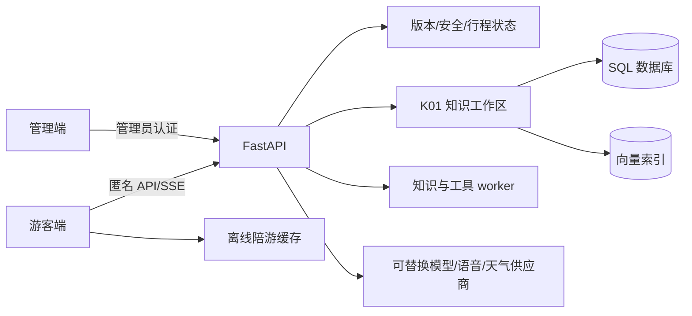

# 技术架构与创新总览

这是当前技术文档的首要入口，把架构、技术组合、技术亮点、创新表述和实现边界放在一起，避免把历史设计、规划能力或模拟演示写成已上线能力。

## 一句话架构

仓库采用游客端与管理端两个独立 Vue/Vite 应用，共用 FastAPI 服务、数据库、知识发布任务和工具 worker；游客侧以共享运行时状态协调问答、地图、播放、CASS、行程和离线入口，管理侧负责知识、资源、审核、发布和运营观察。

详细事实来源：[ARCHITECTURE](ARCHITECTURE.md)、[REPO_MAP](REPO_MAP.md)、[前端边界](frontend/DESIGN_AND_BOUNDARIES.md)。

## 技术组合

| 技术组合 | 实际落点 | 可核对边界 |
|---|---|---|
| 双端隔离 | `frontend/apps/tourist` 与 `frontend/apps/admin` 独立入口、router、Vite 配置和构建目录 | 共用后端不等于生产 origin、TLS 和代理已验收 |
| 证据约束问答 | FAQ/RAG、已发布 revision、来源和知识 epoch 共同约束回答 | 合成向量和 stub provider 不证明真实回答质量 |
| 请求代际隔离 | SSE、播放器、地图、识景、ASR 和 CASS 调度均丢弃迟到结果 | 真机音频焦点、后台恢复仍需实测 |
| 双通道导览 | 普通讲解/行程建议通道与 CASS 安全规则通道分离，由共享状态仲裁 | 模拟预警不等于现场接警系统 |
| 人在回路 | CASS 或模型只生成可审阅提案，游客确认后才保存行程 | 不自动修改游客已确认成果 |
| 持久化工作流 | 知识发布和行程提案由持久 job、幂等键和版本检查保护 | 真实多实例部署和目标数据库仍待验收 |
| 离线陪游 | 游客独立缓存离线页、地图和求助资料，网络恢复后提示返回 | Playwright 模拟断网不替代真机蜂窝网络 |

## 可对外表达的技术亮点

1. 面向现场弱网的可中止流式导览：区分连接存活、业务进展、总时限和完成状态，保留部分结果并允许人工重试。
2. 多来源请求代际隔离：停止、切换或新请求后，旧文字、音频、识景和定位回调不能覆盖当前状态。
3. 知识版本与回答生命周期绑定：草稿不可见，发布 revision 可追溯，知识 epoch 变化会阻止旧证据继续定稿。
4. 安全规则优先于普通生成：CASS 预警可中断讲解和提案，恢复需要明确确认或重新核验。
5. 游客确认驱动的行程工作流：模型或规则只生成差异可核对的提案，确认前不改变行程，重复确认不重复保存。
6. 离线陪游的可解释降级：离线资源、地图和求助资料明确标注核验边界，恢复网络后不自动跳转或伪造在线状态。

## 必须保留的设计思想

- 事实来源和生成语言分离；模型不能凭景点名称臆造室内外、开放状态或安全结论。
- 规则通道和模型通道分离；安全中断、版本检查和权限边界不能由模型自行决定。
- 游客状态有明确权威来源；安全、定位、播放、行程和目录摘要不能在各组件内各自维护一份。
- 所有“创新”都必须对应代码、测试和适用边界，不使用未经证据支持的行业首创或真实安全保障表述。
- GuideMatch 训练能力和候选权重保留，但训练未完成、接口未迁移和独立真实评测未通过前，不接入主问答。

## 详细来源和状态

- [比赛验收总表](integration/ACCEPTANCE.md)
- [合并前审示](integration/MERGE_READINESS.md)
- [GuideMatch 训练记录](integration/GUIDEMATCH_TRAINING.md)
- [CASS 调研与实现边界](integration/RESEARCH.md)
- [现有技术卖点](selling-points/ai-workbench-innovation-points.md)
