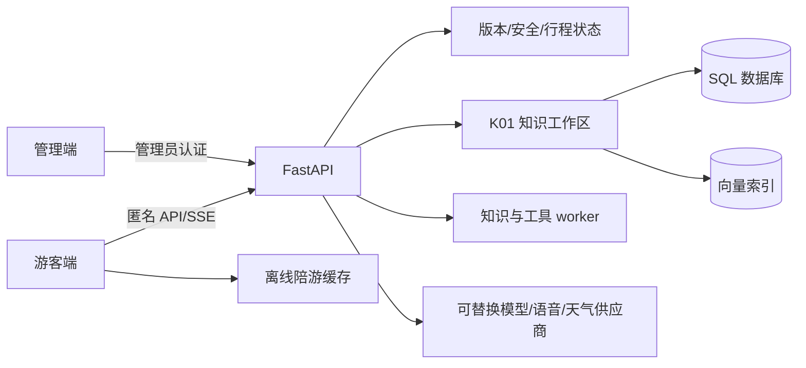

# 技术架构与创新总览

这是当前技术文档的首要入口，把架构、技术组合、技术亮点、创新表述和实现边界放在一起，避免把历史设计、规划能力或模拟演示写成已上线能力。

## 一句话架构

仓库采用游客端与管理端两个独立 Vue/Vite 应用，共用 FastAPI 服务、数据库、知识发布任务和工具 worker；游客侧以共享运行时状态协调问答、地图、播放、CASS、行程和离线入口，管理侧负责知识、资源、审核、发布和运营观察。

详细事实来源：[ARCHITECTURE](ARCHITECTURE.md)、[REPO_MAP](REPO_MAP.md)、[前端边界](frontend/DESIGN_AND_BOUNDARIES.md)。

## 技术组合

| 技术组合 | 实际落点 | 可核对边界 |
|---|---|---|
| 双端隔离 | `frontend/apps/tourist` 与 `frontend/apps/admin` 独立入口、router、Vite 配置和构建目录 | 共用后端不等于生产 origin、TLS 和代理已验收 |
| 证据约束问答 | FAQ/RAG、已发布 revision、来源和知识 epoch 共同约束回答 | 合成向量和 stub provider 不证明真实回答质量 |
| 请求代际隔离 | SSE、播放器、地图、识景、ASR 和 CASS 调度均丢弃迟到结果 | 真机音频焦点、后台恢复仍需实测 |
| 双通道导览 | 普通讲解/行程建议通道与 CASS 安全规则通道分离，由共享状态仲裁 | 模拟预警不等于现场接警系统 |
| 人在回路 | CASS 或模型只生成可审阅提案，游客确认后才保存行程 | 不自动修改游客已确认成果 |
| 持久化工作流 | 知识发布和行程提案由持久 job、幂等键和版本检查保护 | 真实多实例部署和目标数据库仍待验收 |
| 离线陪游 | 游客独立缓存离线页、地图和求助资料，网络恢复后提示返回 | Playwright 模拟断网不替代真机蜂窝网络 |

## 可对外表达的技术亮点

1. 面向现场弱网的可中止流式导览：区分连接存活、业务进展、总时限和完成状态，保留部分结果并允许人工重试。
2. 多来源请求代际隔离：停止、切换或新请求后，旧文字、音频、识景和定位回调不能覆盖当前状态。
3. 知识版本与回答生命周期绑定：草稿不可见，发布 revision 可追溯，知识 epoch 变化会阻止旧证据继续定稿。
4. 安全规则优先于普通生成：CASS 预警可中断讲解和提案，恢复需要明确确认或重新核验。
5. 游客确认驱动的行程工作流：模型或规则只生成差异可核对的提案，确认前不改变行程，重复确认不重复保存。
6. 离线陪游的可解释降级：离线资源、地图和求助资料明确标注核验边界，恢复网络后不自动跳转或伪造在线状态。

## 必须保留的设计思想

- 事实来源和生成语言分离；模型不能凭景点名称臆造室内外、开放状态或安全结论。
- 规则通道和模型通道分离；安全中断、版本检查和权限边界不能由模型自行决定。
- 游客状态有明确权威来源；安全、定位、播放、行程和目录摘要不能在各组件内各自维护一份。
- 所有“创新”都必须对应代码、测试和适用边界，不使用未经证据支持的行业首创或真实安全保障表述。
- GuideMatch 保留训练包与候选权重，并已在 development/test 下受控接入 FAQ 和 GuideLoop 的非精确匹配；模型不可用时保守回退。用户确认采用现有模型，但本次未复现完整训练，真实游客独立评测、许可证与生产运行仍待验证，详见[训练与接入记录](integration/GUIDEMATCH_TRAINING.md)。

## 设计时的核心表述

项目的场景目标是从被动回答扩展到连续伴游：根据游客时间、偏好和有来源的环境信息调整讲解，同时将安全提示交给独立规则通道。可以将其表述为“基于情境感知与双通道事件驱动架构的自适应导览信息流”；这是成熟技术面向景区场景的组合与工程适配，不宣称发明底层算法。位置、天气、客流的来源、时效、精度和模拟属性需要区分；真实客流、危险围栏、后台接警与自动救援不属于已验收能力。

视觉识别提供候选线索，游客确认与已发布景点版本限定后续检索；图片识别、资料发布和答案引用都不能单独证明事实正确。连续行程应保留原需求、提案差异及游客确认，过期或不确定的任务不能静默覆盖新状态；外部调用结果不确定时，重试可能重复计费。

## 技术文书可用的设计表述

面向景区游览过程中游客需求、空间位置与环境状态持续变化，以及传统导览服务响应被动、信息分散、场景适应不足的问题，本项目设计了一种基于情境感知与双通道事件驱动架构的自适应导览信息流。

该信息流将游客位置、环境状态、游览偏好和行程进度转化为统一的情境信息，以情境变化驱动服务决策，结合检索增强生成与工具调用，动态组织讲解内容、播报时机和行程建议；同时，通过独立的确定性规则通道完成信息有效性校验、安全提示与优先级控制，协调数字人、语音、地图和行程的响应。

由此形成“情境感知—信息融合—服务决策—多端呈现—反馈更新”的连续服务闭环，旨在提高现场导览的情境适配性、服务连续性与交互自然度。以上为设计目标；实际接入范围与实证见[验收总表](testing/TESTING_AND_ACCEPTANCE.md)，不能据此宣称效果提升或现场安全保障。

技术文书可按三层组织：多源情境融合（来源、时间、有效性）、生成式服务与确定性约束协同（内容与优先级）、跨数字人/语音/地图/行程的连续交付。游客停止、偏好变更、离开景点与确认行程是反馈；确认前不改已保存行程。完整设计和远期设想见 [CASS 设计案](讨论优化/CASS-Guide-Development-Plan.md)。

## 已确认的知识与游览产品方向

管理员上传、重新导入与单条编辑统一进入持久草稿工作区：发布前人工核对与解决冲突；发布失败保留旧版和草稿，发布固定当时选中的版本，期间后续编辑不应被覆盖。下架后的资料不能继续作为有效知识；解析失败不能静默删除缺失章节。这些是用户确认的设计要求，各文件格式与真实环境仍按专项验收核实。

游客选择“可验证的局部改线”：表单和自然语言围绕同一行程，保留手动修改、锁定项、已游事实与恢复能力；模型提出修改，程序检查并展示差异，游客确认后保存。未知路程、开放时间及预算不能当作已核实；不以模型自己生成的清单证明完整满足用户原话。详见 [行程设计依据](superpowers/specs/2026-10-29-v01-editable-itinerary-design.md) 和[知识工作区设计依据](superpowers/specs/2026-10-27-knowledge-workspace-design.md)，其中细节须与当前代码和验收记录核对。

### 分众讲解与记忆的设计原则

讲解方式可按儿童、休闲和深度等受众调整表达与信息密度，但不得为简化叙述改变事实、年代或名称；游客偏好和历史行为不能充当景区事实依据。早期方案希望复访时延续讲解，并提供清除能力、区分景区范围及避免个性化答案进入共享缓存；匿名标识不能单独证明身份或保证跨游客隔离，跨会话私有记忆及生产隐私边界须以当前实现和专项验收为准。相关后续设计见 [GuideLoop 记忆研究](reports/2026-11-10-guide-memory-research.md)。

## 技术选型与功能约束

采用现有 FAQ、缓存、检索、流式协议与受控任务执行器的增量方案；曾比较 LangGraph 等框架，但尚无同一真实任务链的对照证明其更优，不将选型说成性能优势。详见[框架研究](architecture/FRAMEWORK_RESEARCH.md)。

行程以版本化快照保存必去、排除和时间约束；缺失路段、时长或未解析名称须标记未核实。提案需同时展示原始需求与差异，用户确认后才生成新版本；模型推断出的操作清单不能证明完整覆盖用户要求。浏览器语音识别及部分转写可能直接提交，启发式低置信转写需确认；语音和视觉效果均受实际供应商与设备限制。更完整的功能与证据见[技术草稿](competition/TECHNICAL_DRAFT.md)。

## 详细来源和状态

- [比赛验收总表](integration/ACCEPTANCE.md)
- [合并前审示](integration/MERGE_READINESS.md)
- [GuideMatch 训练记录](integration/GUIDEMATCH_TRAINING.md)
- [CASS 调研与实现边界](integration/RESEARCH.md)
- [现有技术卖点](selling-points/ai-workbench-innovation-points.md)
