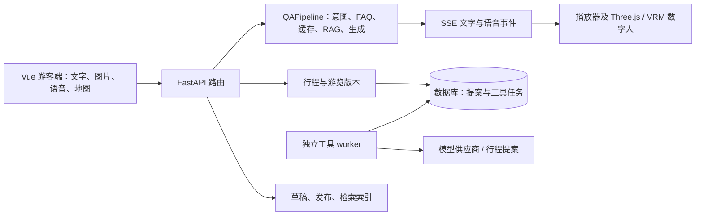

# 当前架构索引

单次 LLM 生成的流事件 drain、生成结果/知识 epoch 检查及 canonical answer 定稿现由 `services/qa/stream_generation_run.py` 的 `StreamGenerationRun` 持有。该对象按请求创建，避免共享 Pipeline 上保存可变 outcome；`QAPipeline` 保留 FAQ/cache/RAG 路由和缓存、持久化及终态事件协调。

代码核对基线为 `codex/competition-integration` 分支（核对于 2026-11-05）；具体提交以 Git 历史和 [开发进度](../development/PROGRESS.md) 为准。问答仍由显式 `QAPipeline` 驱动，FAQ/缓存/RAG 快速通道与 SSE、HTTP/流式 TTS 并行调度；情绪、表达策略和游客记忆是每次流请求的 ContextVar 状态。Pipeline 当前 842 行，负责请求/知识流程、FAQ/cache/RAG 决策及生成配置；`faq_path_resolver.py` 承担视觉/景点范围跳过、FAQ 匹配和既有答案路径解析；`stream_evidence_run.py` 在请求生命周期内选择 FAQ/RAG 证据、发布来源 SSE，并在来源发布前后执行知识 epoch fence；`stream_answer_run.py` 拥有 generation 与 completion 两段嵌套 SSE 流，generation error 会短路 completion，外部关闭会关闭当前内部事件生成器；`cached_answer_path.py` 承担已通过资格判断的共享缓存读取、epoch 检查和答案润色；`stream_turn_factory.py` 将证据约束后的 LLM query、流式 TTS 资格和单次 `StreamTurn` producer 生命周期装配拆出；`fast_path_answer_coordinator.py` 管理快路径的 sources/text/speech/persist/followups/done 顺序及 epoch gate；`stream_turn.py` 组装并拥有单次流请求的 producer、mux consumer、TTS controller、句级音频任务及最终 HTTP 音频尾段/FIFO drain/epoch 检查，还通过 `check_generation_result()` 统一处理 producer 错误和知识失效；`stream_completion.py` 还包含 `StreamCompletionCoordinator`，按序协调 FAQ 文本/音频、完成后 epoch 检查、缓存/持久化以及最终 text/followups/done，并在外层 SSE 关闭时关闭内层音频事件流和取消剩余音频。`stream_generation_run.py` 将单次 StreamTurn 的事件 drain、生成错误/epoch 检查和 canonical answer/terminal policy 定稿收在请求级 run 对象中；`stream_completion_effects.py` 绑定每轮回答的缓存、持久化、降级盲点记录与 done 元数据，副作用顺序仍由 `StreamCompletionCoordinator` 控制。此索引描述源码结构，不代表真实供应商或设备已验收。完整入口见 [功能地图](../REPO_MAP.md)。

- `backend/app/api/router.py` 注册聊天、识景、语音、知识和游览任务；`services/qa/pipeline.py` 与 `intent_router.py` 是问答执行入口。无状态画像提取位于 `services/qa/request_profile.py`，确定性路线回答位于 `services/qa/route_fast_path.py`，整小时预算解析位于 `services/qa/route_constraints.py`；`services/qa/vision_evidence.py` 将游客确认与当前发布目录、检索范围绑定，`services/qa/answer_fast_paths.py` 将最新开放时间/票价不可核实规则、FAQ 直接回答、受众改写证据和共享缓存资格解析为独立决策，`services/qa/evidence_retrieval.py` 将检索片段和带修订/分块 ID 的来源记录成对返回，`services/qa/speech_event_adapter.py` 将 TTS 数据转换为 SSE 音频、字幕和数字人事件。
- 流生命周期辅助件现拆在 `services/qa/stream_turn.py`（组装单次请求的队列、producer、mux 状态/consumer、TTS controller、答案缓冲和句级 HTTP 音频任务；生成后选择未发送音频尾句，按任务顺序 drain SSE，并统一处理异常/取消与知识 epoch fence）、`stream_lifecycle.py`（`StreamProducerGroup` 管理 LLM/TTS producer task 与流式 session 的取消、join、关闭；`AudioTaskGroup` 管理并发 HTTP 音频任务）、`stream_mux.py`（LLM/TTS mux 状态、交付决策和消息读取前后的 epoch fence）、`stream_mux_consumer.py`（消费 mux 事件、保留 SSE 顺序、收集 usage/finish、积累 token、调度句级 HTTP TTS 并驱动 streaming TTS flush）、`streaming_tts_buffer.py` / `streaming_tts_controller.py`（流式 TTS 文本缓冲、发送、finish 和异常降级）、`queued_stream_events.py`（HTTP TTS 生成的 SSE 音频事件队列）、`stream_answer.py`（答案累计与可播句切分）及 `stream_completion.py`（音频尾段选择与 FIFO drain，并由 `StreamCompletionCoordinator` 管理完成后的 FAQ 文本/音频顺序、epoch fence、cache/persist、最终 SSE 终态，以及外层流关闭时内层音频迭代器关闭和任务取消）。Pipeline 仍决定 FAQ/RAG 路由、来源绑定、答案和终态策略，并装配该协调器；FAQ、缓存、RAG、证据绑定及缓存/持久化前后的 epoch fence 必须继续保持。
- 复杂行程操作由持久任务 worker 处理，普通问答不进入通用 Supervisor。后续架构选择仍是显式 Pipeline，不引入运行时 Agent 框架。
- `services/tool_execution/worker.py` 是单独进程；执行器不是自动嵌入 API。它目前只注册 `itinerary.proposal`，不能称为通用多 Agent 平台。
- `frontend/src/stores/tourSessions.js` 负责任务与提案恢复；`useAudioPlayer.js` 管理互斥播放与内容时间轴；`ThreeAvatar.vue` 是 Three.js/VRM 视图。口型是基于文本拼音，非音频驱动模型。
- 已有真实供应商适配，但默认配置包含 stub。历史单次调用不代表当前环境的真实供应商已经可用；景区材料真实性与许可、真实 GPS/客流和手机浏览器能力需分别核验。

`63855db` 后，Pipeline、聊天 SSE 与游客记忆相关回归共 55 passed、1 warning；其中共享 Pipeline 并发回归在旧实现下按预期失败，在请求状态隔离实现下通过。完整集成分支回归尚未重跑；替身测试也不能证明真实模型、语音或移动浏览器可用。历史 SQLite 迁移往返及 PostgreSQL 双会话专项结果见 [W02 集成记录](../development/W02_INTEGRATION.md)，不代表生产数据库升级或多进程故障恢复已验收。

集成分支位于独立副本 `integration-work/v01`；V01、W01、W02、K01 的功能提交均已进入集成历史，其中 durable itinerary execution 后续又增加取消/外部调用 fence、提案幂等重放、目录锁与 worker 生命周期修正。V01 和两个 W02 原始 worktree 仍有未提交差异；相关快照分支保留为 `3805943`、`48ef626`、`5433557`，W02 较早快照与集成版的共享文件有差异，不能作为覆盖来源。`/private/tmp/ai-guide-phase3` worktree 路径已不存在，Git 将它标为 prunable；对应功能分支已在集成历史中，本次没有清理该登记。原主工作区 95 个未提交路径仍保留，快照为 `4acaa53` 和 `e115eab`，尚未将集成结果合回原工作区。`frontend/node_modules` 是本机软链接，不属于源码提交。主工作区 AI/SSE/TTS 流式差异大多已在集成版由后续提交实现；主工作区旧基线还缺少集成版的请求状态隔离、知识版本 fence、图片确认核验和路线约束保护，因此不可用主工作区文件覆盖集成版。合回原工作区前仍须重新核对原目录与目标迁移状态。
