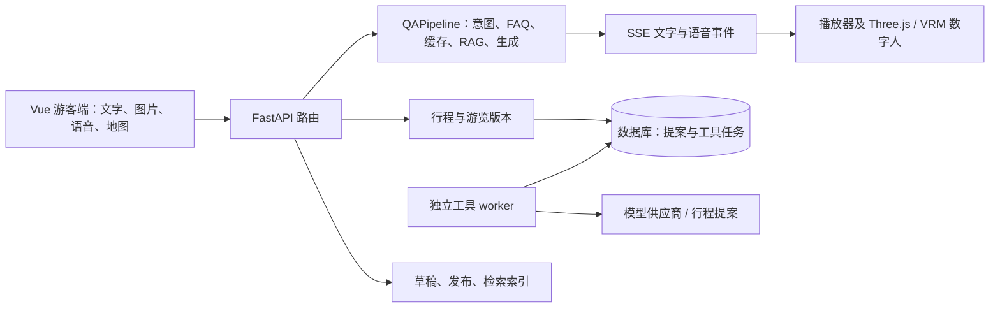

# 当前架构索引

代码核对基线 `63855db`，2026-11-04；后续提交以 Git 历史和 [开发进度](../development/PROGRESS.md) 为准。问答仍由显式 `QAPipeline` 驱动，FAQ/缓存/RAG 快速通道与 SSE、HTTP/流式 TTS 并行调度；情绪、表达策略和游客记忆是每次流请求的 ContextVar 状态。此索引描述源码结构，不代表真实供应商或设备已验收。完整入口见 [功能地图](../REPO_MAP.md)。

- `backend/app/api/router.py` 注册聊天、识景、语音、知识和游览任务；`services/qa/pipeline.py` 与 `intent_router.py` 是问答执行入口。Pipeline 仍是集中式编排模块；复杂行程操作由持久任务 worker 处理，普通问答不进入通用 Supervisor。后续拆分必须保留 FAQ、缓存、RAG、证据和降级路径。
- `services/tool_execution/worker.py` 是单独进程；执行器不是自动嵌入 API。它目前只注册 `itinerary.proposal`，不能称为通用多 Agent 平台。
- `frontend/src/stores/tourSessions.js` 负责任务与提案恢复；`useAudioPlayer.js` 管理互斥播放与内容时间轴；`ThreeAvatar.vue` 是 Three.js/VRM 视图。口型是基于文本拼音，非音频驱动模型。
- 已有真实供应商适配，但默认配置包含 stub。历史单次调用不代表当前环境的真实供应商已经可用；景区材料真实性与许可、真实 GPS/客流和手机浏览器能力需分别核验。

`63855db` 后，Pipeline、聊天 SSE 与游客记忆相关回归共 55 passed、1 warning；其中共享 Pipeline 并发回归在旧实现下按预期失败，在请求状态隔离实现下通过。完整集成分支回归尚未重跑；替身测试也不能证明真实模型、语音或移动浏览器可用。历史 SQLite 迁移往返及 PostgreSQL 双会话专项结果见 [W02 集成记录](../development/W02_INTEGRATION.md)，不代表生产数据库升级或多进程故障恢复已验收。

集成分支位于独立副本 `integration-work/v01`；V01、W02、K01 开发分支均为其祖先。原工作区仍有未提交修改，尚未将集成结果合回原工作区。对照显示主工作区 AI/SSE/TTS 流式差异大多已在集成版由后续提交实现；主工作区旧基线还缺少集成版的请求状态隔离、知识版本 fence、图片确认核验和路线约束保护，因此不可用主工作区文件覆盖集成版。`snapshot-main` 是原主工作区 Git 可见修改的保全快照；合回原工作区前仍须重新核对原目录与目标迁移状态。
