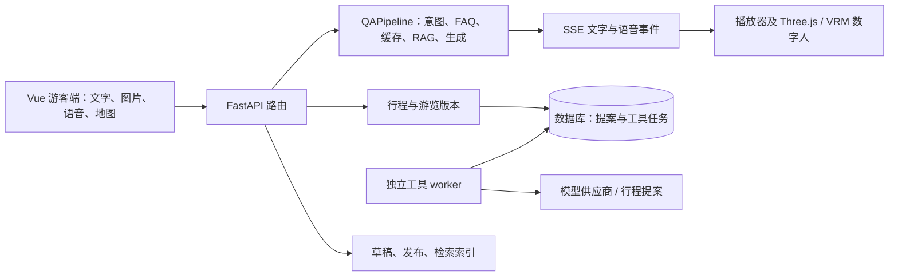

# 当前架构索引

基线 `ec3f7a6`，2026-10-30。此索引描述源码结构，不代表真实供应商或设备已验收。完整入口见 [功能地图](../REPO_MAP.md)。

- `backend/app/api/router.py` 注册聊天、识景、语音、知识和游览任务；`services/qa/pipeline.py` 与 `intent_router.py` 是问答执行入口。FAQ、缓存、RAG 和降级路径需在后续优化中保留。
- `services/tool_execution/worker.py` 是单独进程；执行器不是自动嵌入 API。它目前只注册 `itinerary.proposal`，不能称为通用多 Agent 平台。
- `frontend/src/stores/tourSessions.js` 负责任务与提案恢复；`useAudioPlayer.js` 管理互斥播放与内容时间轴；`ThreeAvatar.vue` 是 Three.js/VRM 视图。口型是基于文本拼音，非音频驱动模型。
- 已有真实供应商适配，但默认配置包含 stub。历史单次调用不代表当前环境的真实供应商已经可用；景区材料真实性与许可、真实 GPS/客流和手机浏览器能力需分别核验。

本地集成基线测试：后端 389 通过、1 跳过；前端 94 通过、构建成功；SQLite 迁移往返成功。W02 使用 fake 模型的测试不证明真实模型联通。PostgreSQL 多 worker、浏览器完整交互与真机尚未验收。
