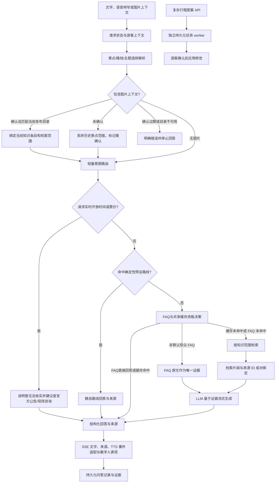

# 目标架构与选择边界

状态：待实测验证；此文是当前最小迁移方向，不表示已完成最终架构。

## 当前选择：显式业务节点，保留 Pipeline 编排

目前保留 FastAPI 与显式 `QAPipeline`，按可验证的业务职责拆分节点。当前代码包括受众画像解析、确定性路线回答、路线预算解析、视觉确认/发布证据绑定、FAQ与缓存快速路径决策、开放时间/票价不可核实规则、RAG来源证据束和TTS事件适配。异步请求生命周期、epoch fence 和 SSE 顺序仍由 Pipeline 控制。复杂行程提案由独立的持久任务 worker 处理，普通问答不进入通用 Supervisor。

对所有快速路径保留知识版本检查、缓存资格判断、来源 ID 及失败回退。共享答案缓存只允许无图片上下文、无游客记忆且情绪中性的请求使用。图片候选和模型自报置信度不建立事实范围；只有游客确认且目录中的景点版本仍为当前发布版本时，才使用条目 ID 限定 RAG。RAG 来源保留知识条目、修订和分块 ID，并绑定具体回答。无实时路况或客流数据时，路线仅基于预设路线，不宣称动态最优。

流式职责按行为边界拆分：`StreamTurn` 组装每请求 producer、mux consumer、TTS controller 与句级音频任务，选择最终未发送音频尾段并负责 FIFO drain/epoch fence 及请求退出；producer 生命周期、mux 消费与 epoch fence、答案累计与句切分、TTS buffer/controller、HTTP 音频交付、最终快路径语音尾段各自可单测。`QAPipeline` 仍是明确的业务请求编排入口，保留 FAQ/cache/RAG 路由、证据绑定、终态降级和持久化；后续拆分需维持事件顺序和取消语义，避免只为缩短文件而迁移隐式状态。

对比候选：A 保留现有 Pipeline 并明确节点/契约；B 局部引入 LangGraph；C 使用其他轻量 Agent 框架。当前选 A，因为现有复杂行程任务已经有持久执行器，尚无实测证明 B/C 能提升正确率、恢复率、延迟或成本。若后续出现现有 worker 难以维护的多分支或跨请求恢复任务，再用固定任务集做隔离 PoC；简单 FAQ/缓存路径需保持不变。选型证据见[框架调研](FRAMEWORK_RESEARCH.md)。

验证缺口：当前可通过自动化测试验证图片确认、目录版本和检索范围的绑定；真实视觉模型识别质量、候选歧义澄清、真实游客资料来源及移动设备端到端表现尚未验证。真实模型/设备环境准备后，才测多模态任务成功率、事实与来源忠实度、语音首响、取消和失败恢复。
