# 目标架构与选择边界

状态：待实测验证；此文是当前最小迁移方向，不表示已完成最终架构。

## 当前选择：显式业务节点，保留 Pipeline 编排

目前保留 FastAPI 与显式 `QAPipeline`，按可验证的业务职责拆分节点。当前代码包括受众画像解析、确定性路线回答、路线预算解析和视觉确认/发布证据绑定；FAQ、缓存、RAG、LLM 及 SSE/TTS 仍沿原有快速路径执行。复杂行程提案由独立的持久任务 worker 处理，普通问答不进入通用 Supervisor。

```mermaid
flowchart TD
  Input[文字、语音转写或图片上下文] --> State[请求状态与游客上下文]
  State --> Select[景点/路线/主题选择解析]
  Select --> Vision{包含图片上下文?}
  Vision -->|确认且匹配当前发布目录| Scope[绑定当前知识条目和检索范围]
  Vision -->|未确认| Unscoped[丢弃历史景点范围，标记需确认]
  Vision -->|确认过期或目录不可用| Stop[明确错误并停止回答]
  Vision -->|无图片| Intent[轻量意图路由]
  Scope --> Intent
  Unscoped --> Intent
  Intent --> Schedule[开放/演出时间或票价核验边界]
  Intent --> Route[确定性预设路线节点]
  Intent --> Fast[FAQ与缓存快速路径]
  Fast -->|未命中或需分众改写| RAG[按知识范围检索证据]
  RAG --> Generate[LLM 基于证据流式生成]
  Schedule --> Answer[结构化回答与来源]
  Route --> Answer
  Fast --> Answer
  Generate --> Answer
  Answer --> Output[SSE 文字、来源、数字人/TTS事件]
  Output --> Persist[持久化问答记录与证据]
  Itinerary[复杂行程提案 API] --> Worker[独立持久化任务 worker]
  Worker --> Confirm[游客确认后应用修改]
```

对所有快速路径保留知识版本检查、缓存资格判断、来源 ID 及失败回退。图片候选和模型自报置信度不建立事实范围；只有游客确认且目录中的景点版本仍为当前发布版本时，才使用条目 ID 限定 RAG。无实时路况或客流数据时，路线仅基于预设路线，不宣称动态最优。

对比候选：A 保留现有 Pipeline 并明确节点/契约；B 局部引入 LangGraph；C 使用其他轻量 Agent 框架。当前选 A，因为现有复杂行程任务已经有持久执行器，尚无实测证明 B/C 能提升正确率、恢复率、延迟或成本。若后续出现现有 worker 难以维护的多分支或跨请求恢复任务，再用固定任务集做隔离 PoC；简单 FAQ/缓存路径需保持不变。选型证据见[框架调研](FRAMEWORK_RESEARCH.md)。

验证缺口：当前可通过自动化测试验证图片确认、目录版本和检索范围的绑定；真实视觉模型识别质量、候选歧义澄清、真实游客资料来源及移动设备端到端表现尚未验证。真实模型/设备环境准备后，才测多模态任务成功率、事实与来源忠实度、语音首响、取消和失败恢复。
