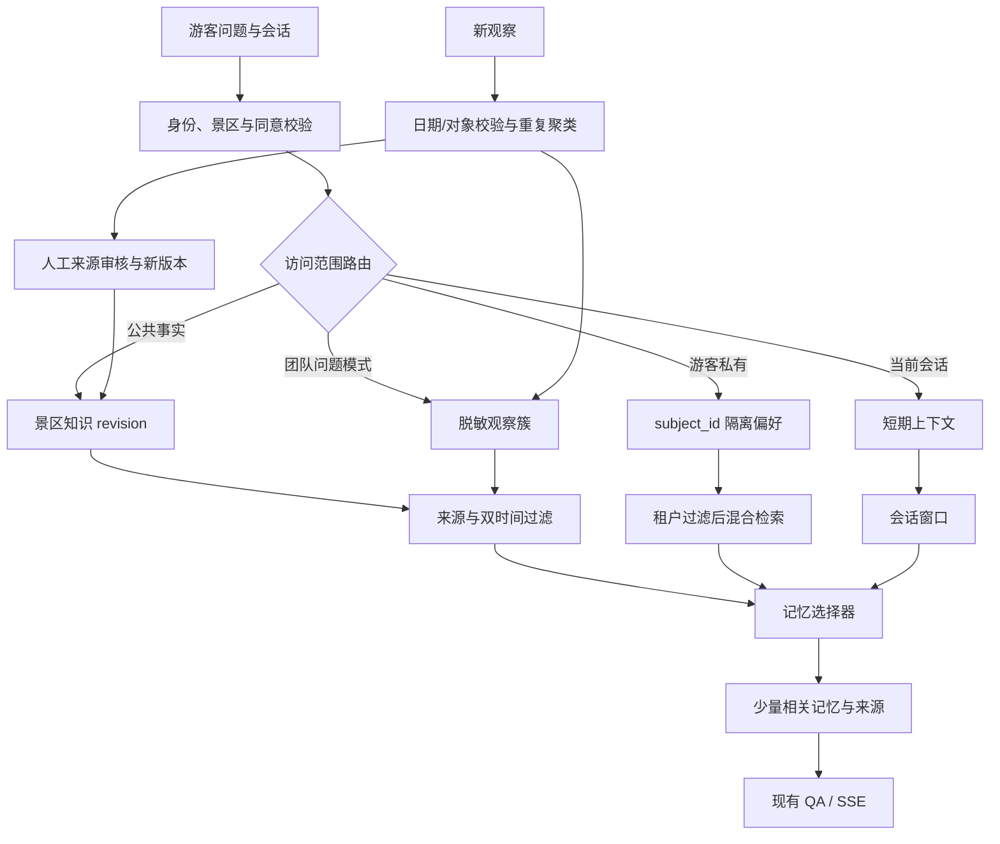

# GuideLoop 场景记忆与多游客回访架构调研

日期：2026-11-11  
结论性质：架构调研与原型方案；不是模型训练结果，也不是生产可用性声明。

## 一句话结论

建议把 GuideLoop 演进为**分层、租户隔离、双时间的记忆增强 RAG 架构**：景区公共事实、团队可复用经验、游客私有偏好和当前会话分层保存，读取时先做身份/景区/同意范围过滤，再检索少量有时效和来源的记忆；现阶段用现有数据库、版本指针和确定性策略落地，不需要先训练一个新底座模型。

## 为什么适合导览场景

导览数据不是一个平面 FAQ 集合，而是四类生命周期不同的信息：

| 记忆层 | 示例 | 共享规则 | 生命周期 |
|---|---|---|---|
| 景区公共事实 | 景点介绍、开放时段、临时公告 | 面向游客共享；来源复核后发布 | 不可变版本、显式生效/失效时间 |
| 团队运营经验 | 高频未答问题、游客常用别称、设备故障模式 | 仅保存脱敏聚合；经审核才进入公共事实 | 持续积累、可纠错和撤回 |
| 游客私有回访 | 偏好语言、亲子同行、讲解深度、已听讲解单元 | 默认仅当前游客；跨会话须明确同意和身份隔离 | 可查看、更正、过期、删除 |
| 当前会话工作记忆 | 刚刚指向的对象、当前路线、这次临时要求 | 仅当前会话 | 会话结束后过期 |

把个人偏好和公共事实放进同一个向量索引，会带来跨游客泄漏、旧事实重新召回和“某游客偏好被当成景区规定”等风险。层级隔离首先解决的是数据治理、时效和检索范围，再改善回答相关性。

## 相关研究与可借鉴部分

- **MemGPT** 把有限上下文视作工作内存，并以显式控制在上下文内外管理记忆。对本项目的借鉴是“按需装载少量记忆并控制上下文”，不是照搬为一个新模型。[论文](https://arxiv.org/abs/2310.08560)
- **Zep / Graphiti** 将对话和结构化业务数据组织成带时间关系的知识图，并保留关系历史。对导览可借鉴“事实何时有效”和“系统何时获知”分开保存，以正确处理公告更新和追溯；首版可以用关系表和 revision 字段实现，不必引入图数据库。[论文](https://arxiv.org/abs/2501.13956)
- **LongMemEval** 将信息抽取、多会话推理、时间推理、知识更新和拒答列为长期记忆能力。它可以指导评测维度；本项目需另建中文导览与隐私隔离样例，不应直接把别的任务分数当成本项目结果。[论文](https://arxiv.org/abs/2410.10813)
- **A-MEM** 研究可动态组织和关联的 agent memory。可作为未来“哪些游客经验彼此相关”的研究方向；由于它依赖模型对记忆结构的自主改写，首版应保留确定性规则和人工审核，避免模型自行改写公开事实。[论文](https://arxiv.org/abs/2502.12110)

这些工作支持分层、时序和主动选择等设计方向，但不证明 GuideLoop 已复现其效果。

## 推荐的系统结构

### 关键数据约束

公共事实和游客私有数据采用不同的访问服务与缓存命名空间。私有记忆至少携带 `site_id、subject_id、memory_type、content、source、consent_state、observed_at、valid_from、valid_until、expires_at、revision_id`。公共事实同时保留 `valid time`（在现实中何时成立）和 `transaction time`（系统何时记录/发布）；游客记忆也保留来源和过期时间。

请求进入 QA 前先做范围判断：游客匿名浏览器 ID 不能直接被当成已认证身份。未有稳定服务端身份和明确同意时，只允许本次会话记忆；公共知识查询不读取游客私有表。个人偏好读取必须先按 `subject_id + site_id + consent_state` 限域，再做关键词/向量召回与重排，默认只注入最多 2 条对当前回答有用的偏好。缓存键包含身份作用域和知识 revision，删除/撤回时使相关缓存失效。

重复观察的相似度只负责“提候选”，范围与时效规则决定能否归并。对象或景点冲突拒绝归并；时间敏感问题要附 `queried_date`，同日可累计，已知异日分簇，日期缺失则进入隔离的待澄清 sibling，不能猜测导入日期。观察聚类产生的是运营线索，不自动变成事实；公共回答必须经过来源审核、技术路由验证和不可变 revision 发布。

## 分阶段实施

1. **当前原型：** SQLite/PostgreSQL 表、revision 条件更新、来源审核声明、观察去重与时效隔离；不训练模型，不使用向量权重。适合本地普通 CPU 环境。
2. **多游客回访：** 引入服务端匿名主体映射、同意状态、私有记忆表和 `subject_id/site_id` 索引；实现读、删、撤回和缓存隔离；以两个以上游客并发请求验证不串记忆。
3. **记忆选择：** 先用规则构造候选，再在固定封存数据上比较关键词、现有 embedding 和 reranker；达到人工标注数据量门槛后才考虑训练一个轻量“记忆选择器”。模型只选择记忆，不直接改写公共事实或发布版本。
4. **规模化：** 基于真实并发和延迟再评估队列、Redis、图存储和跨 worker 条件更新；在测量瓶颈出现前不增加这些依赖。

## 下一阶段验收指标建议

| 指标 | 建议边界 |
|---|---:|
| 跨游客私有记忆泄漏 | 1,000 组对抗访问中 **0 次** |
| 游客撤回同意/删除 | 100 个测试身份中 **100%** 不再检索到旧私有记忆 |
| 时效与更新回放 | 30 条版本更新样例 **30/30** 返回当前有效版本，旧事实泄漏 **0 次** |
| 游客偏好召回 | 30 条人工标注回访问题至少 **27/30** 命中必要偏好，错误偏好注入 **0 次**；未达标则不自动写入偏好 |
| 记忆选择器开销 | 单机并发 20 请求、预热 5 次后 100 次采样，检索阶段报告 p50/p95；原型目标 p95 **≤100 ms**（不含生成模型） |
| 来源可追溯 | 每条公共答案都能回到 `revision_id + evidence_id + source_ref`，缺一项按拒答计 |

这些是下一阶段建议阈值，不是本次已测成绩。当前真实 GuideLoop 18/18 只证明冻结合成场景下的版本和 SSE 路由，不证明私有游客记忆、多用户并发、真实模型增益或长期运营效果。
