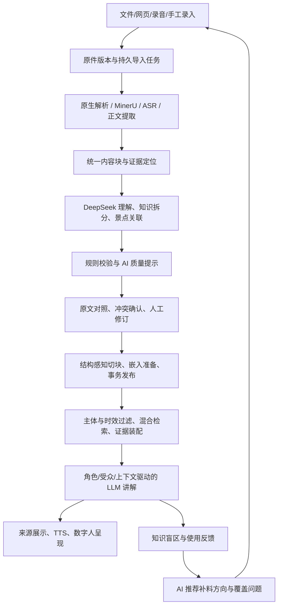

# AI 全过程深度接入的全链路知识管理体系：最终方案

> 来源：本地知识工作树 `codex/knowledge-workspace` 的 2026-11-07 设计和调研记录。本文保留用户的方案表达及研究依据；“最终方案”指当时的设计方向，不表示已全部实施。当前能力与验收见 [知识整合记录](../integration/KNOWLEDGE_UNDERSTANDING.md) 和 [验收总表](../testing/TESTING_AND_ACCEPTANCE.md)。

日期：2026-11-07。定位：比赛版本的统一建设方案与实施依据；本文件确定目标架构，不表示新增功能已经交付。现状来自静态代码核查，本轮未运行模型或业务集成测试。

前置材料：[资料场景与来源考证](2026-11-07-k02-source-research.md)、[DeepSeek 与讲解链路融合分析](2026-11-07-k02-deepseek-narration-integration.md)。本方案是后续实施的统筹入口；前置文档保留考证与分析细节。

## 1. 产品定位与最终决策

建设“面向文旅讲解的 AI 全链路知识管理体系”：将文稿、台账、扫描文献、展牌照片、官网正文和讲解录音转成可审核、可定位、可更新的知识，再供给景点问答、分众化讲解与数字人语音服务，并以游客知识盲区驱动补料。

**核心闭环：多源采集 → 智能解析 → DS 辅助理解 → AI 辅助审核 → 版本化发布 → 证据驱动讲解 → 知识盲区反馈 → 定向补料。**

“AI 全过程”指 AI 的加工结果贯穿各阶段，并得到后续业务使用；不要求每个按钮都实时调用模型。事实来源是采集材料，审核发布由管理员决定，版本、权限、可见性与事务由程序保证。

最终技术选择：

- 保持 FastAPI、SQLAlchemy/Alembic、Vue 3/Element Plus、ChromaDB 和现有混合检索体系。
- 普通文稿采用原生解析，首期使用 `python-docx`、`openpyxl`、标准 CSV/JSON/TXT 处理；文本 PDF 保留 pypdf。MarkItDown 作为未来扩展适配，不作为首期必需依赖。
- 扫描件、图片和复杂版面优先接入 **MinerU 独立解析服务**，通过版本化适配器调用并归一化结果。确定部署方式后先做代表样本验证；如版本/资源不满足，以 PaddleOCR PP-StructureV3 替换该适配器，比赛首期只维护一套重型解析引擎。
- **DeepSeek 为后台语义理解核心**，复用现有供应商配置，新增独立结构化任务接口。在线生成沿用现有证据约束 LLM 接口，不增加每次请求前置理解轮次。
- 录音复用现有 ASR 适配基础，补充文件任务；网页采用 Trafilatura 单页正文提取并提供粘贴正文入口。
- 继续使用现有数据库持久任务和 worker；首期不新增 Redis/Celery、图数据库或训练平台。重型解析独立进程/服务运行。

## 2. 输入产品与支持边界

后台统一入口为“知识采集工作台”，提供文件导入、网页/正文导入、录音导入、手工录入四种入口，汇入同一草稿工作区。

| 来源场景 | 比赛支持目标 | 解析方式 | 使用价值 |
| --- | --- | --- | --- |
| 官方讲解稿与手册 | DOCX、TXT、MD、文本 PDF | 段落/标题/原生文本 | 提取景点背景、特色与术语 |
| 景点/藏品台账与排期 | XLSX、CSV、JSON | 工作表和行列读取、字段映射 | 名称别名、实体信息、条件化服务数据 |
| 扫描文献、图录 | PDF | 按页判定，必要时 OCR/版面解析 | 恢复文字、阅读顺序、图注和表格 |
| 展牌与公告照片 | JPG、PNG | 图像预处理、OCR/版面解析 | 现场资料采集、公告录入 |
| 官网页面 | 单 URL、HTML、粘贴正文 | 正文及元数据提取 | 场馆介绍、运营信息更新 |
| 讲解录音 | 首期验证通过的短音频格式 | ASR、分段及可用的时间定位 | 复用人工讲解经验 |
| 直接维护 | 现有知识编辑 | 人工输入，可选 AI 整理 | 修正、补充、低成本兜底 |

首期演示以文稿、表格、扫描/图片为必备，网页和短录音为增强。旧 DOC/XLS、课件、长视频、复杂古籍碑刻作为后续适配，不在首期 UI 宣称支持。JSON 保留现有 entries 导入兼容路径，AI 整理可选，避免破坏已加工数据。

文件允许列表、实际类型、大小、页数、像素和处理时限统一配置。阈值在部署样本验证后确定，不在文书编造性能承诺。网页只做受限的单页抓取，限制重定向、响应大小和目标地址，失败可转粘贴正文。

## 3. 全链路架构及 AI 职责

| 阶段 | AI 具体产物 | 程序与管理员职责 | 下游实际消费 |
| --- | --- | --- | --- |
| 解析 | OCR/版面结果、ASR 转写 | 类型路由、原件保存、覆盖检查 | 内容块与来源定位 |
| 理解 | 知识卡片、事实引用、分类/别名/景点候选 | Schema 与 ID 校验 | 草稿及主体关联 |
| 清洗 | 断句/格式整理、疑似错字建议 | 保留原文，数字专名改动确认 | 审核后的正文 |
| 审核 | 冲突解释、缺项提示、来源对照、可能可回答问题 | 规则拦截、人工确认 | 发布快照与审核记录 |
| 发布准备 | 已审核主题、结构、辅助检索问句 | 确定性切块、嵌入、原子切换 | 正式检索索引 |
| 讲解 | 依证据生成分众化回答与讲稿 | 可见性检查、来源映射、缓存 | 游客文字、语音与来源卡 |
| 反馈补料 | 缺口分类、检索问题及覆盖候选 | 管理员补料、回放后确认解决 | 下一轮资料建设 |

不对每个阶段重复调用 DS：一次理解任务可同时生成卡片和质量提示；仅在冲突需要分析或管理员请求时追加调用。

## 4. 数据模型：一个事实底座，三层数据产物

### 4.1 原始证据层

复用 SourceDocument / SourceDocumentVersion 保存原件、hash、文件版本；新增可持久化的 DocumentBlock，包含块 ID、原件版本、解析版本、顺序、类型、原始文本/表格及 locator。

locator 按来源保存页码、段落路径、图片区域、工作表/行范围、网页段落或音频时间段。缺乏可靠坐标时使用页级/段级定位；不让模型生成坐标。保留解析覆盖报告，空白页、失败页、扫描页分别记录，混合 PDF 不再静默漏页。

### 4.2 审核知识层

复用 KnowledgeEntry / KnowledgeRevision 及现有草稿、冲突模型。新增 UnderstandingRun 保存输入块、模型/提示词版本、状态、输出、错误、token 用量；新增 KnowledgeEvidence 连接**不可变修订**和来源块；新增 KnowledgeSubjectLink 连接修订和景点主体。

首期主体使用现有“景点信息”条目 ID，建立独立关系，避免把资料条目 ID 与景点主体混为一谈。多份资料可关联同一主体，一份资料可经确认关联多个主体。主体下架后的关联可见性规则统一处理，不自动把其关联资料作为该景点继续展示。

知识卡片字段：标题、正文、分类、别名、内容类型、主题、关联主体、事实及原文引用、可回答问题、有效期、警告及审核状态。小型解释字段可先放版本化 metadata_json；主体、证据、有效期等需要查询和过滤的字段使用明确关系或列。

运营表格额外保存项目、适用条件、时间/价格值与来源行；首次先支持模板化字段确认，不承诺任意合并单元格自动还原。未知有效期、相对日期和歧义条件均待确认。

### 4.3 检索与讲解层

KnowledgeChunk 继续绑定正式修订，增加主体、内容类型、有效期、source block 引用等必要信息。原始长文本保留为可审核的资料知识，AI 摘要不能成为唯一索引内容；生成问句作为辅助召回字段，不能替代事实正文或自动成为 FAQ。

RetrievedDocument 和 sources 事件扩展证据位置、主体及有效期。服务端返回受控原件预览地址，不泄漏存储路径。来源只允许访问当前权限可见的材料。

## 5. DeepSeek 辅助理解的具体实现

新增 `KnowledgeUnderstandingService`，采用非流式结构化调用。复用现有 API 凭据和端点配置，独立设置模型、提示词、token 上限、超时、并发和预算；模型可默认沿用当前配置，不硬编码宣传名称。

输入为有限内容块、邻近标题、分类白名单、已有景点候选、可选的相关已发布卡片。先用名称/别名及检索缩小候选，再由 DS 辅助推荐；不把整个知识库塞入提示词，不做全库两两比较。

输出统一 JSON：cards、facts、evidence、subject_candidates、topic_tags、answerable_questions、temporal_candidates、warnings。模型只引用给定 block_id 和主体候选；材料中的提示语视为资料，不能覆盖抽取规则。

用 Pydantic 校验字段、长度、分类、主体 ID、日期顺序；校验块存在、引用能与原文匹配、数字/专名改动。来源匹配不等于事实蕴含成立，因此仍需审核。确定重复用 hash，疑似语义重复和冲突由模型提出建议，人工决定合并或保留。

JSON Output 的空白、截断、错误内容应有限重试或缩小分批；失败进入“待人工整理”，原文草稿仍可编辑。重新理解生成新候选，不能覆盖人工修订；按输入 hash、块版本、模型、提示词版本及主体目录版本缓存结果。

DS 不承担任意图像识别兜底、事实真伪裁决、自动发布或自动覆盖冲突。图像交给已接入解析服务，必要时再将提取文本交给 DS 理解；确需视觉理解时另行验证接口能力。

## 6. AI 辅助审核工作台

沿用现有草稿工作区与 ImportBatchPanel，增加三类视图：

- **任务视图**：文件级阶段、解析页覆盖、理解结果及失败重试；区分“提取完成”“理解完成”“待审核”“已发布”。
- **对照视图**：原件/原始文本与知识卡片并排，点击事实定位来源，展示改写、错字和关联建议。
- **处理视图**：分类、景点、别名、有效期编辑，重复/冲突确认，批量接受低风险格式建议。

硬阻断条件：来源块失效、必要字段缺失、未解决的现有修订冲突、版本冲突、非法主体关系、无可索引正文。模型错误、模糊字、日期不明等是质量警告；管理员可修订并记录确认，不把模型分数设成不可解释的发布门槛。

与既有规则一致：人工草稿优先保护、重新导入不按文件名覆盖、缺失章节不自动删除、发布固定点击时的修订、批量准备失败保持旧版。

## 7. 结构感知发布与检索

当前 KnowledgeChunker 会压平空白并按句/字符拆分。新增内容块驱动的切块策略：

1. 以标题和段落边界组织事实；长度边界作为保护。
2. 表格按行组切分并重复必要表头，条件与数值共同保存；超长行特殊分段，保留同一行标识。
3. 切块时同步携带证据块和定位，不能在切完后猜来源。
4. 无结构信息的旧知识沿用现有策略，保持兼容。

发布继续使用 KnowledgePublicationService：先准备切块和向量，再事务切换发布指针、递增 epoch；关联主体、证据及有效期必须随所发布修订生效，不随未发布编辑提前改变。

检索统一执行：当前已发布修订、未下架、主体范围、有效期。Chroma、BM25、数据库回退、FAQ 及缓存命中遵循同一可见性语义；索引过时也不能绕过数据库状态。对旧数据无有效期字段保持原行为。

沿用现有向量/关键词召回和精排，增加关联主体范围。结构化运营数据先按条件筛选形成确定事实，再交给 LLM 表达；避免模型从多份互相冲突的排期中自行选答案。候选冲突尚未解决时提示无法确定。

## 8. 深度融合现有讲解链路

在线主链继续复用 QAPipeline：景点/主题解析 → FAQ 或混合检索 → 证据装配 → LLM → TTS 与数字人。后台智能加工增加证据质量和可用结构，在线不再次解析原件。

- **景点讲解**：指定主体检索主条目及关联资料，避免当前 source_entry_id 仅限定单条记录造成补料无效。
- **分众化讲解**：同一事实底稿送入 child/adult/expert 和既有人设；术语解释可辅助表达，记忆与偏好只决定内容选择和语气。
- **自动讲解**：`guide.py` 增加主体 ID、受众、讲解用途和长度预算；组织背景/特色/观赏要点，缺失部分省略，保留现有静态介绍及朗读回退。
- **来源呈现**：语音文本去除引用编号，返回独立 sources 供页面展示，不能因为口播清理而丢失可追溯性。
- **缓存**：问答保留受众与 epoch 语义；自动讲解键加入主体、受众、用途、提示词版本和音色等实际输出因素。自然过期通过缓存 TTL/命中重验处理，不能仅依赖发布 epoch。
- **能力边界**：现有问答具有流式 LLM/TTS；自动讲解当前为全文生成后整段 TTS，首期保留，不宣称所有模式均逐句流式。

## 9. 知识盲区驱动运营

复用 BlindSpotTracker 和现有管理入口，将未解问题归入景点、主题和缺失类型。DS 可推荐需补充的资料与可能匹配的新知识，管理员上传材料并发布后，回放原问题检查检索、证据和回答，确认后标记解决。

现有 BlindSpotResolutionService 通过 FAQ 解决盲区；新增“知识修订关联解决”路径，保留原功能。不得仅凭导入成功或 DS 判断就宣称问题解决。游客反馈形成补料线索，不能直接作为正式事实入库。

## 10. 任务、失败与部署统筹

复用 ImportJob 的持久调度，增加阶段产物：stored → extracting → understanding → validating → drafts_created。阶段名称是建议，迁移时兼容现有 queued/processing/failed/succeeded 与前端契约；待审核属于草稿工作区状态，不混为任务执行失败。

解析成功但 DS 失败时持久保存块，支持仅重试理解或采用人工草稿；解析部分失败时显示覆盖缺口，管理员明确处理后才可发布已确认部分，禁止整份默认完整成功。首次实现可采用整文件失败保留原件的保守路径。

每个阶段保存输入版本、输出版本和错误，使用幂等键避免重试重复卡片；模型调用完成后再次检查租约和原件版本。长任务使用心跳或阶段租约；单纯 `wait_for(to_thread())` 不会终止底层重型运算，解析服务需独立超时/终止机制。

后台 AI 队列限并发，预留游客服务的模型额度；大模型首屏请求优先，导入暂停不影响已发布讲解。保留数据库、原件、解析产物备份，向量索引可由已发布数据重建。沿用现有运维手册，不自动清理唯一草稿或原件。

## 11. 代码落点与实施次序

| 工作包 | 主要位置 | 交付依赖与目标 |
| --- | --- | --- |
| A 统一证据与任务 | `models/knowledge_workspace.py`、schemas、Alembic、`knowledge/imports.py`、`jobs.py` | 先建立内容块、理解任务与证据引用，保留旧导入契约 |
| B 多源解析 | `knowledge/parsers.py` 及新增适配器、`file_storage.py` | 文稿/表格原生解析，MinerU 服务，按页覆盖检查 |
| C DS 理解 | 新增 `knowledge/understanding.py`、LLM 结构化客户端、配置 | JSON 抽取、校验、缓存、原文回退，不改问答流式接口用途 |
| D 审核工作台 | `components/knowledge/`、`views/admin/KnowledgeManage.vue`、工作区 API | 原文对照、主体/有效期确认、AI 警告、冲突保护 |
| E 发布检索贯通 | `publication.py`、`data_import/chunker.py`、`rag/base.py`、检索器及 repository | 结构切块、主体关系、可见性和证据传播；A-D 的闭环关键 |
| F 讲解融合 | `qa/pipeline.py`、`llm/prompt_builder.py`、`api/guide.py`、来源组件 | 分众化、自动讲解结构与 sources、缓存失效 |
| G 运营增强 | 盲区服务、FAQ、缓存、网页与录音适配 | 时效全路径与补料回放，完成后才宣传对应闭环 |

首个可演示增量选择 **DOCX + 展牌图片 + XLSX → DS 卡片 → 人工发布 → 指定景点问答与来源**。E 不能推迟到“只做好导入界面”之后才考虑，否则资料可能已入库却无法参与讲解。随后完成 F，再按余量扩展 G。

## 12. 比赛级验收与展示

采用小规模代表性真实资料，不做无必要的论文评测。最低验收覆盖：

1. 文稿标题与段落、混合 PDF 扫描页、图片方向、表格行列条件不出现明显遗漏/串位。
2. DS 返回空白、格式错误、引用不存在及超时均可恢复，人工编辑不被重跑覆盖。
3. 同景点多份独立资料均能在指定景点问答中命中；草稿、下架和过期内容不因回退或缓存泄漏。
4. 新增发布失败保持旧版；成功后问答与讲解缓存更新；受众缓存不串用。
5. 来源可打开原件位置，语音播放不读引用编号；ASR、模型或 TTS 不可用时基础界面仍可使用。
6. 导入任务中断恢复、不重复创建、游客问答与已有内容演示不受后台重型处理明显影响。

主演示：“同一景点三种资料” → 展示不同解析与 DS 理解 → 修改一处候选 → 发布 → 指定景点提问并查看来源 → 切换受众讲解与语音。准备短样本现场真实导入，已缓存产物明确标注处理状态。

记录实际样本、耗时和错误，不虚构准确率和效率百分比。未完成项在方案中保留为规划，不在成果说明中写成已实现。

## 13. 比赛文书统一表述

建议体系名称：**AI 全过程深度接入的全链路知识管理体系**。

建议技术副标题：**多模态解析、DeepSeek 知识理解与证据驱动讲解协同应用**。

以下为完成对应功能后使用的成果表述：

> 面向景区资料载体多样、知识分散和更新维护困难等问题，系统构建 AI 全过程深度接入的全链路知识管理体系。通过原生文档解析、OCR 版面识别与语音转写实现多源资料采集，利用 DeepSeek 完成语义理解、知识拆分、景点关联和质量辅助审查，将原始资料转化为带来源证据的标准化知识卡片。在人工审核与版本化发布基础上，系统将知识供给混合检索、分众化讲解和数字人语音服务，并依据游客知识盲区形成定向补料与复核流程，实现从资料采集、知识加工到讲解应用和持续维护的闭环管理。

三个创新落点：**资料特征驱动的多模态协同解析、带来源证据的景点知识组织、知识加工与分众化讲解及补料反馈的闭环协同**。技术组件来源如实说明，创新主张落在场景组织和全链路应用，不声称自研通用 OCR、基础模型或未经实现的图谱推理。
