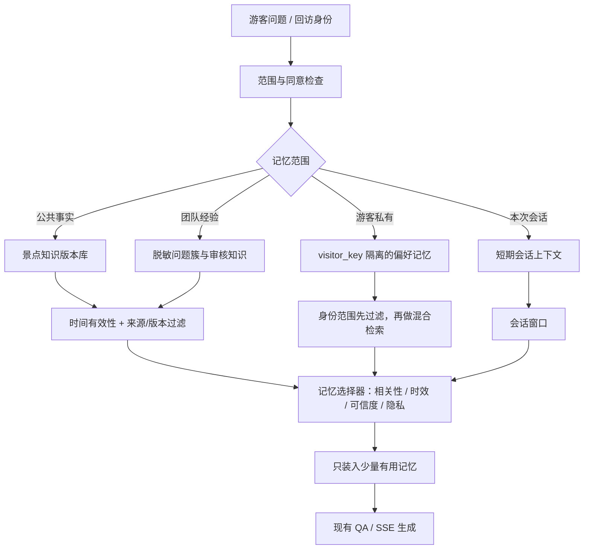

# GuideLoop 两景点知识演化原型实施与测试计划

> **For agentic workers:** REQUIRED SUB-SKILL: Use `superpowers:executing-plans` to implement this plan task-by-task. Steps use checkboxes for tracking. 实施前先阅读工作区与仓库的 AGENTS.md，按 `using-git-worktrees` 隔离工作目录。

**Goal:** 在九龙灌浴和灵山大佛跑通游客追问归并、管理员审核、知识发布、游客新问法复测及撤回，并独立判断 GuideMatch 值不值得接入。

**Architecture:** 复用游客 SSE、管理端登录及盲区页面。在默认关闭的试验范围内，用版本化知识覆盖层承载审核通过的公共条目。先用通用向量和确定性范围规则完成闭环，GuideMatch 只在离线对照通过后替换含糊问句的排序步骤。

**Tech Stack:** FastAPI、SQLAlchemy、Alembic、SQLite、Vue 3、现有嵌入接口、pytest、Playwright。可选模型实验使用本机 PyTorch CPU。

**Spec:** [GuideLoop 调研报告](../../../reports/2026-11-10-guide-memory-research.md)。现有 [O02 待办](../../../code/RuanJianBei/docs/plans/2026-10-28-ai-workbench-backlog.md) 与 [发布链路地图](../../../code/RuanJianBei/docs/REPO_MAP.md) 是对照基线。

## 全局约束

- 工作区主仓库 `code/RuanJianBei` 的已提交基线是 `c54d9ea`，当前树有别的任务留下的暂存、未暂存及未跟踪改动。开始时重新记录 `git status --short --branch` 和 `git rev-parse HEAD`，从已提交基线开隔离工作树，使用临时 SQLite 和隔离端口。禁止清理、暂存、覆盖原树改动。`sources/` 只读。
- 只交付开发／测试原型。`GUIDE_LOOP_PILOT_ENABLED=false` 为默认，仅 `APP_ENV=development|test` 可启用。实验请求必须明确带 `guide_loop` 上下文。后台 API 复用管理员鉴权。所有模拟数据和回放结果标注「模拟／合成」或真实来源类型。
- 两个景点 ID 固定 `bathing`、`buddha`。首轮只做九龙灌浴角色辨认、灵山大佛相似指代对照及九龙灌浴模拟场次。试验覆盖层只接游客文字问答，复用现有 SSE 事件格式。GuideWeave 编排、真实定位、语音供应商、跨进程发布、线上部署和真实运营收益另行验收。
- 最少采集脱敏短问句、会话临时去重键、景点或对象、命中的证据 ID、已播段落 ID（已有才传）和结果码。试验默认只接合成案例或经同意且脱敏的人工走测。未归并的候选数据按 14 天清理，留在版本审计中的只存审核通过的公共知识与必要元数据。
- 现有盲区流程会在写入 FAQ 时标记解决。本试验使用单独的状态机及发布范围。它复用已有问答与管理入口；对已被试验覆盖的事项，生效与撤回决策必须发生在通用 FAQ、答案缓存、RAG 之前。

## 调研转为测试设计

| 参考依据 | 本次采用的做法 |
|---|---|
| [EMNLP 工业论文](https://aclanthology.org/2022.emnlp-industry.22/) 从未识别问句形成簇和代表问法 | 向量只召回候选。是否同一对象、同一适用范围由规则约束，归并结果支持人工修正。 |
| [RAGChecker](https://proceedings.neurips.cc/paper_files/paper/2024/hash/27245589131d17368cccdfa990cbf16e-Abstract.html) 分开诊断检索和生成 | 同题分别看命中的证据、最终回答是否有据。以换入人工确认的证据做定位，区分库缺、漏检索和讲解不清。 |
| [LongMemEval](https://arxiv.org/abs/2410.10813) 单列知识更新、时序和应当拒答 | 冻结回放时钟，单测有效、改期、撤回和同问不同景点。 |
| [GroupShuffleSplit](https://scikit-learn.org/stable/modules/generated/sklearn.model_selection.GroupShuffleSplit.html) 支持按组切分数据 | 问句按 `family_id` 分组切分。同一原始问题及其改写只出现于一个集合。 |

## 验收约定与关键失效情形

1. 不同对象问了相同的话，必须拒绝归并；对象未知且会影响答案，先澄清。由任务 2 验收。
2. 模型相似度高也不能放行日期或对象冲突。已接管事项找不到有效证据时保守提示，禁止跌回旧 FAQ 或 RAG。由任务 3 验收。
3. 草稿、回放失败、并发旧基线和重复发布不得改动现行版本。已撤回的公告不能靠回退复活。由任务 3 验收。
4. 发布前回放只能证明候选版本，发布后必须由真实游客 SSE 路由以新会话复测。刷新页面或重启后仍能命中发布版本。由任务 4 验收。
5. 模型和规则对照用同一份候选集及硬约束。若训练无独立数据或没有测出收益，模型保持关闭。由任务 5 验收。

## Task 1 · 冻结语料与指标

**新增：** `eval/fixtures/guideloop/{manifest.json,pairs_dev.jsonl,pairs_test.jsonl,replay.jsonl,notices.json}`，`eval/scripts/guideloop_eval.py`，`eval/tests/test_guideloop_eval.py`。

- [x] 写评测契约测试。重复 ID、缺期望字段、开发与测试的 `family_id` 相交、负例无明确对象或时间、公告未标模拟，均须导致校验失败。CLI 返回 `0` 通过、`1` 未达阈值、`2` 数据或环境错误。
- [x] 建立语料。真实事实只采用能核查的方志材料，例如九龙灌浴莲花里的太子像。[无锡方志](https://daj.wuxi.gov.cn/doc/2013/03/05/2426800.shtml) 两份资料对大佛右手有不同说法，作为来源冲突用例，期望输出待核。所有场次与时间写为模拟值。[另一份方志](https://daj.wuxi.gov.cn/doc/2013/01/22/2426754.shtml)
- [x] 固定 20 条开发配对，40 条封存配对。封存集恰好包含 20 条可复用、12 条不可复用、8 条需澄清；不可复用至少 6 条跨对象、4 条时效冲突。每条含 `case_id, family_id, left, right, expected, reason, origin`。每个问句对象含 `text, poi_id?, target_id?, unit_id?, queried_date?`。冻结文件哈希，标注人核对期望，按组拆分。题量用于小样本原型验收。
- [x] 固定 18 条独立游客回放，V1/V2/V3 各 6 条。每版覆盖本对象两种问法、另一对象、无指代、对前一版内容的试探、普通域内问题回退。每条预期含 `decision, required_claims, forbidden_claims, source_ids, expected_revision`。不同日期与对象至少各有一组「文本完全相同、期望不同」的反例。
- [x] 先跑 `python -m pytest eval/tests/test_guideloop_eval.py -q`，再跑 `python eval/scripts/guideloop_eval.py validate --fixtures eval/fixtures/guideloop`。校验输出必须列出固定条数及哈希。以后阈值只用开发集定，封存集失败要保留记录；如调参重测，另建独立封存批次。

## Task 2 · 归并与运营待办

**新增：** `backend/app/schemas/guide_loop.py`、`backend/app/services/guide_loop/matching.py`、`backend/app/models/guide_loop.py`、`backend/app/repositories/guide_loop.py`、`backend/app/api/guide_loop.py`、对应单头 Alembic 迁移和 `backend/app/tests/test_guide_loop_matching.py`。注册至 `backend/app/api/router.py`。

**接口：** `match_pair(left: QuestionContext, right: QuestionContext, score: float, threshold: float) -> MatchDecision`，三种结论 `reuse|distinct|clarify`，附 `reason_code`。管理员 `POST /api/admin/guide-loop/observations` 录入已脱敏事件，`GET /api/admin/guide-loop/cases` 列出按独立会话计数的问题簇。`event_id` 幂等，同一 `session_key + cluster_id` 对需求计数只加一次。

- [x] 先写匹配及鉴权测试。覆盖同义改写、已确认的跨对象、日期冲突、缺失指代、同一事件重发、同一会话多次追问和非管理员请求。关键字段均未知且影响复用时不能因高向量分自动通过。
- [x] 实现候选排序，复用现有中文嵌入接口，top 5 足够用于两站。先用确定性规则处理已知冲突，再按开发集固定阈值处理候选。测试替身只用于隔离单测；真实向量评测因本机缺少模型权重且网络不可用未执行，已留存 `not_run_insufficient_data`/环境错误说明，见验收报告。
- [x] 按 `missing_fact|retrieval_gap|explanation_gap|stale_or_conflict|technical|unknown` 记录运营归因。首版用运行线索提供建议，由人工决定；至少让 `retrieval_gap` 能发布别名关联，让 `stale_or_conflict` 能发布公告更新或撤回。其余类别在后台保留处理状态，首版不要求接 GuideWeave 自动讲解。
- [x] 在隔离后台演示以管理员导入脱敏事件作为待办输入，保留对应游客回放编号。线上自动收集另行接入。读取待办和导入事件时执行过期清理，测试 14 天前的未处理样本会删除，已发布知识及审核记录仍可查。
- [x] 从 `backend/` 运行 `python -m pytest app/tests/test_guide_loop_matching.py app/tests/test_blind_spot_admin.py app/tests/test_faq_semantic_gate.py -q`。从仓库根目录尝试运行 `python eval/scripts/guideloop_eval.py pairs --variant rules --fixtures eval/fixtures/guideloop --out <隔离证据目录>`；因本机缺少权重且网络不可用，真实向量评测未执行，已保存原因，不以替身结果冒充。

## Task 3 · 版本发布与游客 SSE

**新增：** `backend/app/services/guide_loop/publication.py`、`backend/app/tests/test_guide_loop_publication.py`、`backend/app/tests/test_guide_loop_chat.py`。**修改：** `api/guide_loop.py`、`schemas/chat.py`、`core/config.py`、`api/chat.py`、`services/qa/pipeline.py` 和任务 2 的持久化文件。所有文件路径相对后端根时均以 `app/` 开头。

**接口：** `POST /api/admin/guide-loop/cases/{id}/draft` 接受 `base_revision`、`action=add_alias|replace_fact|withdraw`、`target_id`、`evidence` 和有效区间。`POST .../verify` 由服务端对候选别名快照执行正、负确定性路由检查并保存结果；`replace_fact` 继承当前版本别名；响应明确 `fact_checked=false`，它不验证来源是否支持回答。管理员发布时必须提交 `source_reviewed=true` 人工核验声明，服务端在不可变 revision 上记录声明与时间戳。旧版本迁移后的默认声明为 false；此类版本只返回“待来源复核”并暂不提供旧答案，管理员重新审核并发布后恢复。`POST .../confirm-live` 记录实际路由结果与管理员明确选择的通过/失败，条件匹配当前案例 revision 后才关闭或重开。观察事件保存可选 `queried_date`；同日问题可累计，已知异日分簇，缺日期的时序问题进入隔离的待澄清 sibling 并返回实际簇 ID。游客 `ChatRequest.guide_loop` 是可选上下文，含 `poi_id` 与 `unit_id`。试验时钟只可通过测试依赖注入，浏览器不能覆盖服务器当前时间。

- [x] 完成当前原型状态机验收：过期 check 拒绝关闭新版本、旧对象 check 不得关闭同 case 新对象版本、管理员确认失败重开、撤回/未复核旧版返回 unavailable、有效期起点含且终点不含、旧 FAQ 不泄漏、提交失败不切指针且回滚版本均有测试。技术回放只测路由与结构；事实支持关系由服务端强制记录管理员人工声明，但系统没有自动事实核验能力。
- [x] 发布保护已覆盖旧基线 409、并发同基线仅一次成功、重复发布返回同一版本、提交失败回滚和旧别名累积；另以独立数据库会话覆盖同案例的旧草稿发布、旧草稿验证、旧指针保存和旧案例快照覆盖竞态，旧操作均不得覆盖新状态。多 worker/跨数据库方言的并发一致性仍未验证。
- [ ] 游客路由只精确命中已登记别名。新增未登记改写探针 `莲花里面那个小朋友到底是谁呀？` 返回 GuideLoop `pass` 后进入通用 QA/RAG，stub 索引无知识时给出“不明确记载”答复；这确认了 fallback 路径，但未验证真实 FAQ/RAG 会否泄漏该事实。证据见 `unregistered_paraphrase_probe.json`。尚未证明能拦截已接管事项的任意新问法；已覆盖撤回时旧别名阻断旧 FAQ 与旧 check 不能关闭新版本。
- [x] 最终全量后端测试通过：345 passed / 3 skipped / 1 弃用警告。测试时钟从 `APP_ENV=test` 的 app state 注入。
- [x] Task 3 的事务失败回滚、FAQ/cache 撤回拦截、时间边界、旧基线与并发发布现已覆盖；跨 worker、多数据库方言仍是部署验收边界。

## Task 4 · 管理界面与端到端回放

**新增：** `frontend/src/components/GuideLoopPilotPanel.vue`、`frontend/src/api/guideLoop.js`、`eval/browser/guideloop_pilot.cjs`。**修改：** `frontend/src/views/admin/BlindSpotManage.vue`、`docs/REPO_MAP.md`、`docs/ARCHITECTURE.md`、`eval/README.md`。前端入口同时要求开发构建、`VITE_GUIDE_LOOP_PILOT=1` 和后端可用，复用管理员登录。

- [x] 后台面板基础流程能走通真实 API/SSE；各 case 表单、验证、发布和复测状态独立。案例列表返回受保护的草稿、验证记录和当前活动 revision；刷新后可恢复。任何表单编辑使技术验证和人工声明失效，保存期间禁用输入并检查迟到响应，刷新立即清除旧草稿的人工作用声明。真实浏览器脚本用两个独立案例验证隔离、刷新、声明失效和活动 revision。
- [ ] 未见问法泛化尚未通过验收：浏览器脚本仍复问登记 alias；精确别名命中不代表语义改写鲁棒性。最终回放完成后已关闭并用同一 SQLite 重启服务，新游客 SSE 仍命中相同 revision、答案和 evidence ID，证据见 `restart_probe.json`。生产多 worker/其他数据库方言与更广跨对象覆盖仍未验收。
- [x] 用固定测试时钟和隔离 SQLite 在新增来源声明、观察日期和管理员复测结果后运行 `guideloop_eval.py replay`，18/18。结果见 `eval/results/guideloop-pilot-2026-11-10/actual_http_replay_final/`；只证明当前冻结合成案例，不证明未见问法泛化或事实来源真实性。
- [x] 运行 `node eval/browser/guideloop_pilot.cjs` 并导出桌面／手机 PNG。真实页面和 FastAPI 的浏览器流程通过；视口 1440×900 与 390×844，手机表单单列，未捕获页面异常。证据见 `eval/results/guideloop-pilot-2026-11-10/screenshots/`、`ui_manual_verification.json`。执行脚本加入 Playwright 开发依赖；npm audit 安装摘要为 15 项漏洞（1 low、4 moderate、9 high、1 critical），本任务未做依赖升级。
- [x] 最终重跑前端测试和构建：79 passed / 1 skipped；Vite build 通过（仍有 >500 kB chunk 提示）。Playwright 两案例刷新恢复、人工声明、发布、真实 SSE、关闭、手机单列和无页面异常通过。

## Task 5 · GuideMatch 可选实验

**新增仅在进入实验时：** `eval/scripts/train_guide_match.py`、`eval/tests/test_guide_match_eval.py`。训练日志、权重和运行报告保存在隔离输出目录，记录底座名、权重版本、可训练参数、随机种子、数据哈希与 CPU。初期冻结编码器只训分类头；是否解冻最后一层由开发集决定。已有本机随机权重冒烟只证明算力可用，不能作为效果基线。

- [x] 只有在主闭环已通过，并有至少 200 条经人工核对的独立训练问句对、每类至少 30 条、以及封存集未被用于训练时才开始。合成问句标明来源。无数据则记录 `not_run_insufficient_data`，完成主计划。
- [x] 按前置门槛检查并跳过三组模型对照：当前没有至少 200 条经人工核对的独立训练问句对，且本地缺少所需嵌入权重、网络不可用。记录为 `not_run_insufficient_data_and_weights`；因此 B/C/C0 模型实验、混淆矩阵和增益结论均不适用，不能宣称训练或模型收益。

## 必过指标与证据交付

以下是原型验收线，均为本计划设定的阈值，实施前冻结。`pass`、`clarify`、`unavailable` 单独计数；无法判断的案例不能算作有据答对。

| 指标 | 通过条件 |
|---|---|
| 正确归并召回 | 封存集至少 **16/20** 个正例输出 `reuse`。 |
| 错误归并 | **0/12** 个不可复用对输出 `reuse`；**8/8** 个必须澄清对输出 `clarify`。同时报告 `TP/(TP+FP)`，分母为所有实际归并，不能靠一律拒绝通过。 |
| 版本回放 | **18/18** 个用例命中预期决策。可答样例的必需陈述与来源 ID 均正确，禁止陈述 **0 次**出现。逐条人工核验引用是否支持关键陈述，不能只检查引用编号。 |
| 发布保护 | 非法请求、回放失败、提交失败不切版本；旧基线 409；重复发布幂等；并发测试只有一个成功；撤回后旧文本/证据泄漏 **0 次**。 |
| 新游客闭环 | 浏览器走通一轮真实管理操作与 SSE 新会话复问；重启后再做一次 HTTP/SSE 复问。 |
| 本地开销 | 固定两站小语料、单客户端顺序测量，预热 5 次，再测 30 次。试验解析到返回证据的服务端 p95 **≤300 ms**。报告 CPU、样本数与 p50/p95；首个完整文本和端到端时间另记，计时不含模型首次加载。超标时注明实际值并定位。 |

另外保留 **A 冻结当前系统、B 常规盲区＋人工补 FAQ、C 完整 GuideLoop** 的游客输出对照。给 B/C 同一批初始资料、同一修改预算，记录实际审核分钟与使用的语料版本。主闭环按上表验收。相对 A/B 的收益必须用实际结果表达；发现 A/B 已经能答对的用例照实记入，不能把所有改善都归给模型。

- [x] 交付 `metrics.json`、逐条 `predictions.jsonl`、三个版本的 SSE 回放和 `report.md`。报告列出代码提交、语料哈希、测试命令、样本性质、失败案例、训练状态与未验收项。评测失败不删除记录。
- [ ] 测量 B/C 人工编辑审核分钟数。用户确认目前没有人工计时数据；自动化脚本和 HTTP 对照不能替代真人审核时间。继续作为明确未验收项记录。UI 截图 PNG 已导出（见上）。
- [x] 文书边界。通过核心验收可写「两景点原型验证了知识新增、修订和撤回」。模型实际训练并通过独立对照后才写训练方式和样本内收益。长期现场维护效果、多 worker 一致性和真实游客满意度仍需额外证据。

交给下一模型时，要求按任务 1–4 顺序实施，在隔离工作树留存每阶段证据；任务 5 按数据与对照门槛决定是否执行。先交付核心闭环，再报告专用模型增量。

## 后续扩展 · 多游客回访与并发读取

这部分是下一阶段设计，单独验收。面向「多位游客返回」不能把所有历史写进共享向量库后直接检索；公共导览知识、团队运营经验、匿名游客偏好、当前会话要分区存储并隔离读取。建议采用**分层、租户隔离、双时间的知识记忆架构**：

数据项最少保存 `scope、site_id、subject_id、content_type、source、confidence、observed_at、valid_from、valid_until、expires_at、consent_state、revision_id`。公共事实仍以已审核 revision 为准；团队经验通过匿名问题聚类形成候选，审核后才变成公共知识；游客偏好仅在显式同意、稳定匿名 key 经过服务端签发并做缓存隔离后跨会话读取，孩子同行、讲解速度等临时要求默认只属于当前会话。私有记忆读取前先按 `subject_id` 与 `consent_state` 限域，再做关键词/向量候选召回与轻量重排；时间冲突按有效时间和写入时间双轴处理。提供查询、更正、过期和删除路径。

多顾客并发首先是**数据隔离、版本一致性与写入幂等**问题，不应先训练一个“多游客模型”。保留追加式事件、不可变 revision、条件更新活动指针；持久化优先沿用现有 PostgreSQL/SQLAlchemy，可先以 `site_id + subject_id + valid_time` 索引与事务控制，达到实际吞吐瓶颈后再引入队列/缓存或图数据库。短期原型先做规则化记忆选择器和租户泄漏测试；之后按真实样本和 LongMemEval 类任务评测检索、时序推理、知识更新与拒答。研究依据、阶段目标和建议验收指标见[场景记忆调研报告](../../reports/2026-11-10-guide-memory-research.md)。

| 记忆范围 | 内容与读取规则 |
|---|---|
| 本次游览 | 当前站、实际播完的单元、本次明确要求。用于即时讲解；本次要求优先于历史偏好。 |
| 游客私有 | 游客明确保存的偏好、确认听过的关键讲解。按服务端验证的游客身份和景区隔离，允许关闭、查看和清除。未验证身份时只用本次游览状态。 |
| 景区共享 | 审核发布的公共事实、FAQ 别名与讲解素材。每条记录区分现实有效期和系统发布版本；只用当前问题适用且已审核的证据。 |

读取时先判定有没有必要读私有记忆，再限定对象和时效，仅选最多两条对当前回答有用的记录。游客说「这次带孩子」只影响这次，除非主动选择保存。已有 `visitor_id` 来自客户端，适合作为现有匿名偏好入口的线索；增加服务端身份校验、记录隔离和缓存隔离后，才用于跨会话私有记忆。个人偏好控制讲解深浅、顺序和是否复述，公共事实仍由发布版本决定。采用可变偏好的按需读取思想和双时间记录的思路。首版用现有数据库表和少量规则复现这两点。 [Memory Retrieval for Changing Preferences，2026 年预印本](https://arxiv.org/abs/2606.02976) · [Zep 时序记忆论文](https://arxiv.org/abs/2501.13956) · [现有游客记忆结构](../../../code/RuanJianBei/backend/app/models/visitor_memory.py) · [聊天请求](../../../code/RuanJianBei/backend/app/schemas/chat.py)

多人同时提问时，在服务端复用同一景区、同一对象、同一有效证据版本的公共检索结果。每次读取仍检查当前时间是否在有效区间。带私有记忆的答案和音频在请求内生成，跳过公共答案及音频缓存。发布后新请求只取新快照。发布前已开始的流有明确版本归属，另测跨撤回边界的行为；普通更新与紧急撤回分别确定策略。

- **回访回放建议。** 先用两名游客、同一景点和同一个问题做 12 条脚本。覆盖正确续讲、本次要求优先、异地无关偏好、另一游客同问、访客身份不匹配、清除记忆、公共公告改期。比较关闭私有记忆、直接注入既有画像、按需选择三组。验收按用例逐条核对适用偏好命中、旧偏好误用和公开事实版本；身份错误、清除后仍命中或跨游客泄漏均要求 0 次。该小样本只验证机制。 [PersonaMem](https://arxiv.org/abs/2504.14225)
- **并发回放建议。** 使用 1、10、30 个并发客户端，混合公共问答和两种不同游客画像，并在测试中间发布一个新版本。统计错误率、p50/p95、公共证据缓存命中率、跨用户串用和发布确认后新请求的旧证据泄漏。后两项要求 0 次。先记录本机容量与瓶颈，按实际部署再制定吞吐目标；当前单请求 300 ms 门槛不外推到并发。
- **模型升级条件。** 规则与既有画像无法稳定处理偏好冲突时，才训练轻量记忆选择器。学习目标是「此条记忆加入后，是否让当前答案更合适且仍然有据」，单列正确采用、错误采用、正确忽略。保持同一公开证据、生成器和样本，做有无记忆选择器的对照。
