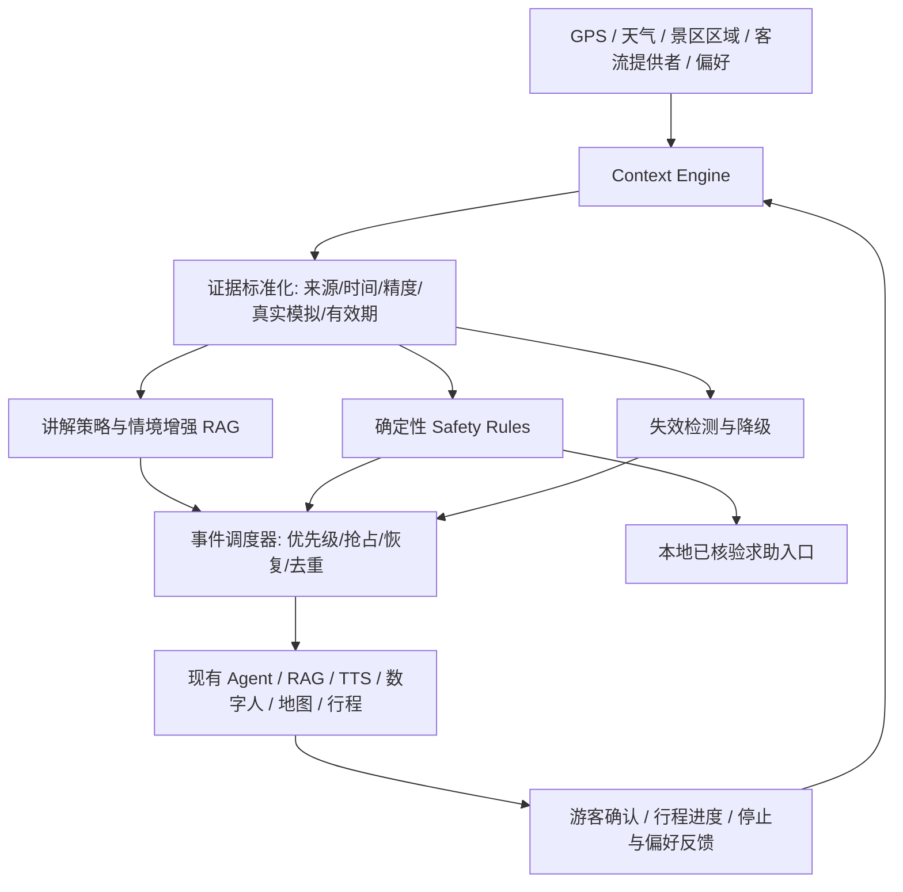

# CASS-Guide：情境感知与安全约束的自适应 AI 数字人导览设计案

> 状态：**设计基线；首版实现范围与验收状态见 [`docs/implementation/CASS_GUIDE.md`](../implementation/CASS_GUIDE.md)，未覆盖部分仍为待实施设计**  
> 创建日期：2026-11-04  
> 更新日期：2026-11-07（根据本轮讨论补充架构定位、信息流与比赛创新表述）  
> 目标仓库：`yumir3297/RuanJianBei`  
> 讨论分支：`feat/location-guide-opt`  
> 性质：比赛场景创新提案，不是实际已部署能力或真实安全保障承诺。  
> 关联现有草案：[`safety-guard-mode-2026-11-02.md`](./safety-guard-mode-2026-11-02.md)

## 0. 一页摘要与边界

**设计目标**：在保留景点知识问答、RAG、地图、Live2D、语音与离线应急能力的前提下，新增一条可审计的情境数据链路，让 AI 基于用户位置、天气、客流等级、游览时间及偏好调整讲解主题、信息密度、播报时机，同时用独立的确定性安全规则在有依据的情况下打断常规讲解并提供辅助安全提醒与人工求助入口。

核心特点：
1. **情境证据增强讲解**：环境状态先校验来源、时效、定位精度、模拟/真实属性，再影响 RAG 检索与讲解策略。
2. **安全优先的双通道执行**：确定性规则生成安全事件；LLM 只负责正常讲解与非紧急解释，不能作出无依据的安全保证。
3. **事件抢占与恢复**：高优先级事件抢占普通讲解，去重/冷却，完成后有条件恢复。
4. **证据失效降级**：弱网、数据过期、定位精度差时停止基于失效数据的判断；可使用已经校验的离线地图、应急联系信息和缓存讲解。
5. **可实测**：设计明确的对照实验、指标和失败用例，所有性能数字都必须来自真实测试，不预填结果。

**非目标**：不追求全景区在线人员监控、真实人数统计、自动救援调度、摔倒/疾病检测、全时后台定位、无人审批自动封路、真实事故率下降承诺。纯 Web 在锁屏/后台无法保障持续定位；“辅助安全提示”不等于“确保人身安全”。

### 0.1 核心定位与信息流设计

**方案名称：基于情境感知与双通道事件驱动架构的自适应导览信息流。**

面向景区游览过程中游客需求、空间位置与环境状态持续变化，以及传统导览服务响应被动、信息分散、场景适应不足的问题，本项目设计了一种基于情境感知与双通道事件驱动架构的自适应导览信息流。

该信息流将游客位置、环境状态、游览偏好和行程进度转化为统一的情境信息，以情境变化驱动服务决策，结合检索增强生成与工具调用，动态组织讲解内容、播报时机和行程建议；同时，通过独立的确定性规则通道完成信息有效性校验、安全提示与优先级控制，协调数字人、语音、地图和行程的响应。

由此形成“情境感知—信息融合—服务决策—多端呈现—反馈更新”的连续服务闭环，旨在提高现场导览的情境适配性、服务连续性与交互自然度。

**双通道的职责：**
- **生成式服务通道**：负责需求理解、个性化讲解、行程建议及调整原因解释，结合已有 RAG、模型和工具调用能力组织服务。
- **确定性规则通道**：负责数据有效性检查、安全提示与服务优先级控制，约束生成式服务的执行边界。
- **统一事件调度**：协调两条通道的输出，管理播报、抢占、去重与有条件恢复，使同一次服务决策在数字人、语音、地图及行程上保持一致。

**反馈更新的含义：**游客确认修改行程、离开当前景点、停止讲解或调整偏好后，相关行为返回情境层，影响下一次服务决策。信息流随游览过程持续更新；行程变更须经游客确认，避免静态建议与实际游览脱节。

**本轮确定的比赛与首版边界：**
- 创新定位为成熟技术在景区连续游览服务中的架构设计与场景应用创新；重点展示情境如何转化为有效服务。
- 首版提供游客本地安全提醒与求助入口，不建设后台接警、受理及状态回传链路；旧草案中的安全值班台保留为远期扩展。
- 首版验收以应用闭环有效、既有问答/识景/语音/停止/重播功能不退步为主；第 7 节对照研究与统计指标作为后续评估参考，不作为首版交付的全部前置条件。
- 当前采用“设计”“旨在提升”等措辞；开发与验收后，依据实际交付范围更新为“实现”“支持”，效果提升须有实际记录。

## 1. 现有代码映射（在 2026-11-04 前次代码审阅基础上，实施前必须重新核实）

| 现有位置 | 可复用能力 | 接入风险 |
|---|---|---|
| `frontend/src/composables/useGeolocation.js` | browser geolocation、WGS84→GCJ-02、真实/模拟模式与精度状态 | 当前模拟模式设置了看似精确的 accuracy；必须严格分离模拟与真实安全事件 |
| `frontend/src/views/tourist/MapView.vue` | Leaflet 地图、景点/路线、演示客流、讲解入口 | 当前客流为演示算法；不可冒充实时真实人数 |
| `frontend/src/composables/useNarration.js` | 基于位置的讲解触发 | 需在升级后审查是否适合接入事件与任务调度 |
| `backend/app/api/router.py` | FastAPI 路由注册 | 需按升级后业务层接口决定挂载方式 |
| 已有 RAG、Live2D、TTS 与离线应急页 | 知识来源、数字人播报、弱网/离线退化 | 复用优先，避免重新造 Agent 和音频通道 |

上述是此前读取分支代码得到的设计映射，不代表现有最新分支已实现本设计。架构重构期间禁止依赖旧路径进行硬编码开发。

## 2. 总体架构：情境感知与双通道事件驱动



不是新增一个独立大模型或重型多 Agent 平台。应优先把本设计作为**现有主 Agent 的情境输入/策略插件**与**独立的安全规则模块**。统一的“安全状态”由规则引擎计算，不能通过自由文本 Prompt 让 LLM 直接判定。

### 2.1 情境快照契约（示例，不是真实数据）

```json
{
  "schema_version": "1.0",
  "snapshot_id": "ctx_demo_001",
  "site_id": "demo_site",
  "captured_at": "2026-11-04T10:00:00+08:00",
  "location": {
    "lat": 31.0, "lng": 120.0, "coordinate_system": "GCJ-02",
    "accuracy_m": 18, "source": "browser_gps", "mode": "real",
    "observed_at": "2026-11-04T09:59:58+08:00"
  },
  "weather": {
    "condition": "rain", "source": "weather_api",
    "observed_at": "2026-11-04T09:58:00+08:00",
    "expires_at": "2026-11-04T10:08:00+08:00"
  },
  "crowd": {
    "zone": "zone_a", "level": "high", "trend": "rising",
    "source": "simulated", "usable_for_real_world_safety": false
  },
  "visitor": {"interests": ["history"], "remaining_minutes": 40},
  "validity": {"location": "valid", "weather": "valid", "crowd": "demo_only"}
}
```

所有字段需定义单位、坐标系、数据来源、采集时间、过期规则、空值语义；服务端重新校验关键字段，拒绝伪造 `mode=real` 的客户端自报信任。浏览器 GPS 可被模拟，因此不能视作可信人员定位证明。

### 2.2 Context Engine

- **输入**：景点知识索引、GPS、天气/官方预警、游客自选兴趣与时长、`CrowdProvider` 的分区状态。
- **处理**：时效校验、坐标系统一、围栏距离与定位误差带计算、缺失值降级、状态变动阈值/冷却时间。
- **输出**：结构化 `ContextSnapshot` 与 `ContextEvent`，仅在有实质变化时触发下游处理；避免 GPS 每次更新都调用 LLM。
- **隔离**：模拟客流和模拟巡游仅可供 Demo/测试使用，不可触发真实 SOS/值班告警，也不可生成“现场实时拥堵”的确定性表述。

### 2.3 讲解策略（Narrative Adaptation）

行动空间：`full_narration`、`short_narration`、`defer_narration`、`route_suggestion`、`resume`。可用轻量规则或加权评分选择，初期不训练模型。

示例评分：`U(a|s)=wR*relevance + wP*preference_fit + wT*time_fit - wD*disruption`，权重为待测试超参数，并非已验证算法。**硬安全规则优先于该评分**。

RAG 只负责有证据的景点事实检索；LLM 依据情境和已检索事实生成自然讲解，必须支持事实引用/来源追踪与无知识证据时退化为基础说明。

### 2.4 Safety Rules（不由 LLM 自由决定）

最低集合：
- 用户主动 SOS：本地立即展示已验证的求助方式与最近可用位置（标注时效/精度）；首版不发送后台接警通知，也不展示“已送达/已受理”状态。
- 危险区域提示：进入已核验的多边形危险区域附近，考虑定位 accuracy、连续多次确认及抖动滞回。
- 天气预警：仅使用有效期内、已核实来源的预警；不得用普通“下雨”自动推断“高危”。
- 不可信定位/后台挂起/离线：禁止基于不可靠坐标发出确定性的个人安全结论，显示状态与人工求助途径。

事件优先级建议：`SOS > verified_critical_warning > verified_zone_warning > regular_narration`。事件具有 ID、source、timestamp、severity、acknowledge 状态。安全播报优先使用预审核模板，避免紧急路径等待 LLM/TTS 云端生成。

## 3. 调度与体验规则

1. 当前正在播放的普通讲解可被更高优先级事件抢占，暂停/停止时明确处理音频队列；保留能够安全恢复的讲解段落。
2. 相同状态事件以事件 ID 和时间窗口去重，并设置冷却周期；需测试边界抖动、快速重复触发、并发播放、事件解除。
3. 用户能够关闭主动讲解；SOS 按钮和已核实应急信息不应因关闭普通讲解而隐藏。
4. 本地安全提醒与求助入口说明实际可用操作；首版不提供后台接警受理，不展示远端发送、受理或救援启动状态。
5. 将环境状态在 UI 上以可理解方式展示：`实时/过期/演示`、定位质量、风险来源、恢复状态。

## 4. 客流最小实现方案

先定义可插拔的接口 `CrowdProvider.getZoneState(site_id, zone_id)`，返回 `level/trend/source/observed_at/confidence`。

- `SimulationProvider`：确定性、可重放的演示数据；界面必须醒目标注“模拟”。
- `ManualProvider`：授权管理者录入分区状况，附记录时间和操作者。
- `LiveProvider`：未来对接可靠客流来源；没有真实数据就不要展示真实估算人数。

当前不必引入 H3、Redis、闸机或摄像头。如以后引入匿名上报，需明确授权、去重、覆盖率偏差和隐私措施；“上报设备数”不是“真实游客人数”。原安全守护与客流控制草案保留作远期扩展参考。

## 5. 与升级后架构的接入约束

**在当前集成架构上实施前，重新审计代码路径并隔离开发**：

1. 找出主 Agent 状态图/调度入口、工具协议/Function Calling、RAG 检索、TTS 播放队列、位置与地图状态管理、离线状态机的真实新路径。
2. 定义 `ContextSnapshot`、`ContextEvent`、`NarrationDecision`、`SafetyEvent` 的契约、版本与权限边界，避免在核心 Agent 内嵌业务私有字段。
3. 先接入情境增强讲解，再接入安全抢占，再接入可插拔客流；每一步有自动测试。
4. 严禁直接覆盖架构升级中的改动。使用**独立 worktree / feature branch**，以升级完成后的稳定提交为基线，审查 diff 和测试通过后再合并。
5. 保持单一定位采集源、复用播放队列；不要让两个 watcher 重复获取 GPS、多个音频播放器争抢输出。
6. 优先复用已有 RAG/Agent/Voice/Map/Offline 组件，禁止为比赛堆叠无必要的强化学习、多 Agent 协商、复杂数据库或自研定位算法。

### 建议模块（名称仅为接口草案；以升级后新目录为准）

```text
backend/app/services/context_engine.py
backend/app/services/narration_policy.py
backend/app/services/safety_rules.py
frontend/src/composables/useGuideContext.js
frontend/src/components/GuideContextStatus.vue
frontend/src/components/GuideSafetyNotice.vue
```

## 6. 分阶段实施

| 阶段 | 交付物 | 必须验收 |
|---|---|---|
| G0 架构审计 | 最新代码映射、依赖图、接口契约、迁移风险清单 | 不改变正在重构的核心代码 |
| G1 情境讲解 | Context Engine + 情境增强 RAG + 讲解策略 | 不同有效情境产生有理由的不同讲解；同状态不反复重生成 |
| G2 安全协同 | 规则引擎 + 播放抢占/恢复 + SOS 入口 | 事件优先级正确；弱网与定位失效不误报 |
| G3 客流适配 | Simulation/Manual providers + 动态推荐 | 演示数据不冒充真实人数；分区调整可影响导览建议 |
| G4 验收与文书 | 场景测试、对照数据、演示脚本、评分映射 | 报告包含可复现环境、版本与实际结果 |

## 7. 可复现实验方案（目标不是已实测成绩）

**实验组**：A 固定预设讲解；B 普通 RAG 讲解；C 情境感知 + RAG + 安全约束。

**场景集**：30–50 个确定性可重放用例，覆盖正常天气、下雨、拥挤度等级变化、兴趣差异、定位漂移、区域边界抖动、数据过期、无网络、SOS、告警抢占/解除、讲解队列竞争。

**建议验收指标**（待依据部署环境调优，不代表真实效果）：
- 标注场景上的策略选择准确率目标 ≥95%，报告混淆矩阵和失败例。
- 确定性安全规则用例 100% 通过；绝不以“规则测试通过”宣称现实人身安全已经确保。
- 客户端收到高优先级事件后，进入预审核安全提醒播放流程的 p95 目标 ≤1s（不包含未知网络传输延迟，必须明确测量边界）。
- 所有模拟位置与模拟客流场景均不得被记录为真实安全证据。
- 过期/拒绝定位/离线时不得生成无依据的位置安全保证。
- 对比讲解相关性、事实正确性、用户感知干扰、首字/首播延迟、LLM 调用次数与 Token 成本；输出 p50/p95、样本量、置信区间及失败案例。

**测试方法**：后端规则单测 + 前端状态机单测 + Playwright 场景 E2E + 人工盲评讲解；离线页面沿用原有离线验收规范。每条测试标注 `real`、`simulated`、`manual` 的数据性质。

## 8. 对照传智杯 Web+AI 赛道评分

> 下表根据项目此前整理的《2026传智杯WEB赛道要求(1).md》（基于官方赛道截图）进行设计映射。是**评分契合点**，绝非承诺获得该比例分数；后续需核对最终官方版本。

| 评分维度 | 总成绩权重 | 本模块提供的可展示证据 |
|---|---:|---|
| AI 技术深度 | 35% | 真实 Agent 工作流、情境工具调用、RAG、AI 安全约束、语音/地图联动 |
| 创新性 | 25% | 从被动回答到环境事件驱动主动服务；可解释情境自适应；安全优先抢占 |
| 前端工程质量 | 10% | 解耦组件、低频事件更新、状态机与资源复用（仍需全站工程质量） |
| 实用性 | 10% | 有效改变讲解与辅助安全提示，和固定讲解作对照 |
| 用户体验 | 10% | 动态播报、事件提示与恢复、失效反馈、移动端可用性 |
| 社会价值与商业潜力 | 10% | 景区辅助安全与自助导览，未来可配置多景区部署 |

AI 技术深度内部对应：大模型集成 8%、Agent/工作流 8%、RAG 6%、多模态 5%、安全可控 4%、MCP/工具集成 4%；创新性内部对应：选题 10%、技术方案 8%、交互 7%。这些是官方评分细项权重，**并非本模块的预测得分**。

## 9. 创新应用与文书措辞

### 9.1 三层创新应用

| 层次 | 文档表述 | 对应设计与可展示行为 |
|---|---|---|
| 信息组织 | **面向游览任务的多源情境融合** | 将位置、天气、偏好与行程进度组织为统一情境，保留来源、时间及有效状态，使环境变化能够成为服务决策依据 |
| 服务决策 | **生成式推理与确定性约束协同的服务决策** | 模型负责理解与生成，规则负责边界与优先级，共同决定讲什么、何时讲、是否建议调整，并解释实际触发原因 |
| 体验交付 | **跨交互载体的连续导览协同** | 将同一次服务决策同步体现为数字人讲解、语音播报、地图提示与经确认的行程变更，保持各功能响应一致 |

以上为本项目的架构与场景应用创新定位，不将所用开源框架或基础技术表述为自研算法。展示重点是更合时宜的讲解、更连贯的服务和更清楚的调整理由。

### 9.2 可直接用于技术文档的核心表述

面向景区游览过程中游客需求、空间位置与环境状态持续变化，以及传统导览服务响应被动、信息分散、场景适应不足的问题，本项目设计了一种基于情境感知与双通道事件驱动架构的自适应导览信息流。

该信息流将游客位置、环境状态、游览偏好和行程进度转化为统一的情境信息，以情境变化驱动服务决策，结合检索增强生成与工具调用，动态组织讲解内容、播报时机和行程建议；同时，通过独立的确定性规则通道完成信息有效性校验、安全提示与优先级控制，协调数字人、语音、地图和行程的响应。

由此形成“情境感知—信息融合—服务决策—多端呈现—反馈更新”的连续服务闭环，旨在提高现场导览的情境适配性、服务连续性与交互自然度。

### 9.3 答辩简述与标题

**答辩简述：**

> 我们围绕景区现场游览设计了一种情境驱动的自适应导览信息流，通过生成式服务与确定性规则双通道协同，将环境变化和游客需求转化为数字人、语音、地图与行程的一致响应，使导览服务能够随游览过程持续调整。

**推荐技术文档标题：面向景区连续游览服务的情境感知与双通道协同导览信息流设计。**

### 9.4 表述与交付证据

- 设计阶段使用“设计”“提出”“旨在提升”；完成开发与验收后，按实际范围使用“实现”“支持”。
- 用流程图、真实界面、关键代码和连续场景演示支撑应用创新；用实际记录说明效果与适用边界。
- 不在缺少依据时声称全球/全国首创、实时全景区人数、全天候精准定位、确保人身安全或降低事故率。
- 模拟位置、天气事件与客流在演示中明确标注，不包装成真实现场数据；不预填尚未测出的性能或评分结果。

## 10. 文档治理与下一步

本文件为**新方案基准**，旧草案 `safety-guard-mode-2026-11-02.md` 仍保留作为详细远期安全/客流扩展设计。本轮仅修订本设计稿的定位、信息流与相关首版边界，保留旧草案及业务源代码。

架构升级完成后，执行文档审计：按“现行 / 待实施 / 历史草案 / 过时待归档”分类；建立单一设计索引；检查与最新实现的偏差；逐份决定保留、合并、归档或删除。所有破坏性操作先给出清单和影响说明，再执行。

## 11. 参考与技术依据

- 本仓库：`docs/讨论优化/safety-guard-mode-2026-11-02.md`（现有安全守护与客流扩展草案）。
- 本仓库现有 `useGeolocation.js`、`MapView.vue` 与离线应急说明（实施前重新审查最新分支）。
- W3C Geolocation API / MDN Geolocation：浏览器权限、Secure Context 与位置 API 限制，https://developer.mozilla.org/en-US/docs/Web/API/Geolocation_API 。
- H3 官方文档（未来可选空间网格技术；本期非必需），https://h3geo.org/docs/ 。
- GuardAgent, ICML 2025（安全约束智能体相关研究方向），https://proceedings.mlr.press/v267/xiang25a.html 。
- 关于情境感知推荐与生成式 AI 导览的研究可作为前沿背景；正式竞赛文书需逐项核对引用的原始文献与结论。

---
**说明**：本文保留设计目标与边界；代码实际接入范围以 `docs/implementation/CASS_GUIDE.md` 和验收记录为准，未实现的设计能力不能视为已交付。

