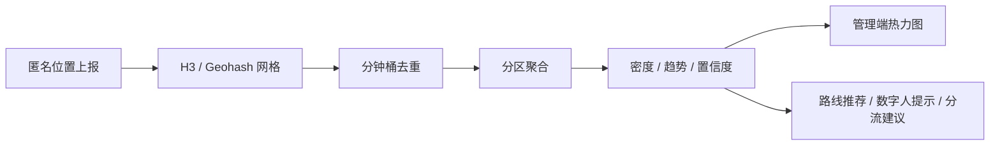
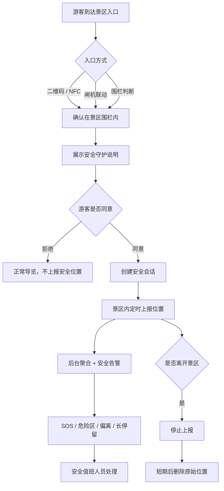

# 景区安全守护与客流控制：实施草案

- 日期：2026-11-02
- 状态：草案，待评审
- 分支：`feat/location-guide-opt`
- 范围：景区范围内的辅助安全定位、匿名客流密度统计与分流建议
- 不包含：医疗判断、摔倒检测、绝对安全承诺、默认全量位置监控

> 本文是实现草案，不是已经完成的功能。当前代码中的定位仅用于自动讲解，尚未向后台上报位置；客流仍为演示模型。

## 1. 背景与目标

大型景区、山地/水域/夜间游览等场景存在走失、偏离路线、危险区域进入、拥挤踩踏等管理风险。现有系统只在前端使用定位，管理后台无法看到安全状态，也没有真实客流密度。

本方案希望提供两类能力：

**辅助安全**

- 游客进入景区后，可开启“安全守护模式”
- 只在景区范围内上报位置
- 管理后台可按景区/区域/时段选择性开启
- 安全值班人员可处理 SOS、危险区域、长时间停留等告警
- 离开景区后自动停止并删除实时位置
- 普通运营人员只能看聚合数据，不能看个人位置

**客流控制**

- 匿名统计分区设备密度
- 识别拥挤区域、趋势与置信度
- 为路线推荐、数字人提示、管理端分流提供依据
- 与安全守护共用匿名标识和围栏，但数据、权限、保留时间分开

### 目标

1. 为大型、有管理风险的景区提供辅助安全与客流控制能力。
2. 安全模式默认关闭，最小化采集，游客可控。
3. 客流统计匿名、聚合，不展示个人位置。
4. 在 Web 能力范围内做到可解释、可降级、可审计。

### 非目标

- 不承诺 100% 实时、室内精准、摔倒检测或医疗判断。
- 不默认采集所有游客位置。
- 不把位置用于广告、画像或与安全无关的运营分析。
- 不把“同意安全守护”作为入园强制条件，除非有明确法律依据和替代方案。
- 不自动控制闸机、门禁或封路，硬控制必须人工确认。

## 2. 两条数据链路要分开

| 维度 | 客流密度统计 | 安全守护模式 |
| --- | --- | --- |
| 目的 | 拥挤度、路线推荐、讲解节奏 | SOS、走失、危险区域、偏离路线 |
| 标识 | 匿名 `visitor_id` | 匿名 `visitor_id` + 安全会话 |
| 位置精度 | 网格/分区 | 原始坐标（短期） |
| 上报频率 | 30–60 秒 | 10–20 秒，SOS 时立即 |
| 数据保留 | 聚合 10 分钟 | 原始 30–60 分钟，事故快照按制度 |
| 可见范围 | 运营看聚合 | 安全值班人员看个人 |
| 权限 | 普通后台 | RBAC + 审计 + 紧急授权 |

两条链路共用匿名标识和地理围栏，但**不要共用同一张位置明细表**。

### 2.1 客流控制与密度统计

客流控制的目标不是“看住某个人”，而是回答三个问题：

1. 哪个区域现在挤？
2. 挤到什么程度、还在不在上升？
3. 应该往哪里分流？

#### 数据来源

| 来源 | 作用 | 现状 |
| --- | --- | --- |
| 匿名定位上报 | 实时趋势、分区密度 | 当前未接后端 |
| 闸机/票务分时人数 | 总量校准 | 未接 |
| 管理员手动更新 | 分区拥挤度修正 | 未接 |
| WiFi/BLE 探针 | 覆盖未打开页面的设备 | 需硬件与合规评估 |
| 摄像头 AI 人流 | 分区精确计数 | 需硬件与算法 |
| 历史同期模型 | 冷启动/基线 | 当前 [MapView.vue](../../frontend/src/views/tourist/MapView.vue) 为演示模型 |

所有来源必须在状态表里标注 `source` 和 `confidence`，不能把模拟客流说成实时客流。

#### 数据链路



#### 上报规则

- 仅在景区范围内上报。
- 页面可见时上报，页面不可见时停止或降频。
- 30–60 秒一次；站着不动也要发心跳，避免 TTL 过期。
- 精度差于阈值不上报。
- 使用匿名 `visitor_id`，不使用手机号、MAC、设备指纹。
- 后端只保留网格中心/分区，不保留原始轨迹。

#### 去重计数

关键是**按设备去重，不是按上报次数计数**。

Redis 精确计数：

```python
key = f"crowd:{site_id}:{cell}:{minute_bucket}"
redis.sadd(key, visitor_id)
redis.expire(key, 600)

# 最近 5 分钟
keys = [f"crowd:{site_id}:{cell}:{b}" for b in range(bucket - 4, bucket + 1)]
tmp = f"crowd:tmp:{site_id}:{cell}"
redis.sunionstore(tmp, *keys)
redis.expire(tmp, 60)
count = redis.scard(tmp)
```

大规模可用 HyperLogLog：

```python
redis.pfadd(key, visitor_id)
count = redis.pfcount(*keys)  # 多 key 并集基数，约 1–2% 误差
```

网格建议：

- H3 resolution 9，约 0.1 km²
- 或 Geohash 6，约 1 km × 0.6 km
- 再把网格映射到景区分区（前山/后山/湖区/广场）

#### 指标定义

```text
observed_devices = 时间窗口内唯一设备数
density_index    = observed_devices / cell_area
zone_load        = observed_devices / zone_capacity
trend            = EWMA_1min / EWMA_15min
confidence       = f(设备数, 上报新鲜度, 覆盖率)
crowd_level      = 与同区域、同小时、同星期基线比较后的分位等级
```

示例：

```json
{
  "zone": "qianshan",
  "observed_devices": 186,
  "density_index": 0.81,
  "crowd_level": "high",
  "trend": "rising",
  "confidence": 0.72,
  "source": "location_report",
  "window_seconds": 300,
  "updated_at": "2026-11-02T10:31:12+08:00"
}
```

#### 校准与样本偏差

- `observed_devices` 不是“人数”，只是“上报设备数”。
- 一人多设备会高估；不开页面/不授权会低估。
- 用闸机人数做校准：

```text
penetration   = observed_devices / gate_count
estimated_total = observed_devices / penetration
```

- `penetration` 会随时间、人群变化，状态表必须保留 `confidence`。
- 少于 5 台设备的网格不展示，避免小样本泄露。

#### 客流控制动作

**软控制**（系统可自动建议）：

- 路线推荐避开高密度区域
- 数字人提示“当前梵宫排队较长，建议先游览五印坛城”
- 管理端推送分流建议
- 推荐“最佳游览时段”

**硬控制**（必须人工确认）：

- 入口限流
- 单向游览
- 临时封闭区域
- 安保/引导员调度
- 广播与应急疏导

AI 可以生成建议、摘要和广播文案，但**不能自动控制闸机、门禁或封路**。

#### 客流 API

```http
POST /api/crowd/report        # 匿名位置上报
GET  /api/crowd/state         # 游客端/数字人读取分区密度
GET  /api/admin/crowd/state   # 管理端聚合
POST /api/admin/crowd/actions # 分流/广播/派员，人工确认
```

#### 客流数据保留

- Redis 分钟桶：10 分钟 TTL
- 分区快照：可按小时聚合，不含个人标识
- 原始上报点：不落库
- 告警/人工处置：按运营制度保留

#### 与安全守护的关系

- 客流统计：匿名、聚合、普通运营可见
- 安全守护：单独同意、个人位置、安全角色可见
- 两者可以共用 `visitor_id` 和围栏，但**接口、表、保留时间、权限分开**。

#### 客流控制的落地阶段

- **Phase 5A**：匿名上报 + H3/Geohash 去重 + 分区密度 + 管理端热力图；客流仍保留模拟兜底并标注 `simulated`。
- **Phase 5B**：接闸机/人工分区修正；路线推荐和数字人提示接入密度。
- **Phase 5C**：WiFi/BLE/摄像头接入；拥堵预测与异常检测。

#### 客流验收标准

- 同一 `visitor_id` 多次上报只计 1 台设备。
- 最近 5 分钟窗口可正确聚合。
- 分区 `crowd_level/trend/confidence/source` 可查询。
- 管理端可看热力图，但默认看不到个人位置。
- 少于 5 台设备时不展示具体数值。
- 模拟客流必须标 `source: "simulated"`。
- 原始上报点不落库，TTL 到期删除。

## 3. 总体流程



## 4. 入口与边界

### 4.1 入口方式

| 方式 | 做法 | 优点 | 缺点 |
| --- | --- | --- | --- |
| 入口二维码/NFC | 扫码/碰一碰后开启 | 明确、可控、可告知 | 需要游客操作 |
| 闸机联动 | 检票后下发开启链接 | 覆盖准 | 需要票务系统对接 |
| 围栏判断 | 最后一次定位进入围栏后开启 | 无感 | 需要进入前就有一次定位 |

推荐：**入口二维码/NFC + 围栏校验**。既明确告知，又能确认游客确实在景区内。

### 4.2 进入/离开判定

- 进入使用外圈，离开使用更大的外圈，做滞回。
- 离开确认后延迟 3–5 分钟停止，避免边界抖动。
- 定位精度差于阈值时不上报，提示“定位不可用”。
- 离开景区后不再保留实时位置。

示例参数（待现场校准）：

```text
ENTER_RADIUS_M = 200
EXIT_RADIUS_M = 300
EXIT_CONFIRM_MS = 180000
MIN_ACCURACY_M = 80
```

### 4.3 为什么不能“进入前也一直上报”

只在景区内上报是数据最小化要求。为了知道“什么时候进入”，可以使用：

- 入口二维码/NFC 的明确动作
- 闸机/票务联动
- 最后一次已知位置做围栏校验

不要为了判断进入而长期后台采集位置。

## 5. 管理后台开关

建议做成景区级配置，而不是全局硬编码：

```json
{
  "site_id": "lingshan",
  "safety_mode_enabled": true,
  "enabled_zones": ["houshan", "huqu"],
  "enabled_periods": ["2026-11-02T08:00/2026-11-02T18:00"],
  "retention_minutes": 30,
  "allowed_roles": ["safety_manager", "on_duty_staff"],
  "require_user_consent": true
}
```

规则：

- 默认关闭。
- 只有管理员能开启/关闭。
- 开启/关闭写审计日志：谁、何时、哪个景区/区域、原因。
- 可以按区域、时间段、活动开启。
- 开启后游客端显示明确提示，例如“安全守护已开启”。
- **后台开启 ≠ 游客同意**，仍然需要游客授权。

## 6. 游客授权

位置属于敏感个人信息，建议在入口单独展示：

> 为保障游览安全，景区可开启“安全守护模式”。开启后会仅在景区范围内采集你的位置，用于 SOS、危险区域提醒和走失寻找。离开景区后自动停止，原始位置最多保留 30 分钟。你可以拒绝，拒绝不影响正常导览。

要点：

- 与浏览器定位权限分开说明。
- 提供随时关闭入口。
- 未成年人需要监护人同意。
- 拒绝后仍可使用导览，只是没有安全守护。
- 不能把“同意安全守护”作为入园强制条件，除非有明确法律依据和替代方案。

## 7. 数据模型

### 7.1 景区安全配置

```text
site_safety_config
  site_id
  enabled
  enabled_zones_json
  enabled_periods_json
  retention_minutes
  allowed_roles_json
  require_user_consent
  updated_by
  updated_at
```

### 7.2 安全会话

```text
safety_session
  session_id
  site_id
  visitor_id
  started_at
  last_seen_at
  ended_at
  status            # active | ended | sos | resolved
  entry_method      # qr | nfc | gate | geofence
  consent_version
  consent_at
```

### 7.3 最新位置（Redis，短期）

```json
{
  "session_id": "safe_xxx",
  "visitor_id": "anon_xxx",
  "lat": 31.4285,
  "lng": 120.0998,
  "accuracy": 25,
  "ts": 1730000000,
  "zone": "qianshan",
  "source": "web"
}
```

Redis key：

```text
safety:pos:{site_id}:{session_id}   TTL = retention_minutes
safety:active:{site_id}             Set，在线安全会话
```

### 7.4 告警

```text
safety_alert
  alert_id
  session_id
  site_id
  type              # sos | danger_zone | route_deviation | long_stay | inactivity
  level             # info | warning | critical
  lat / lng
  created_at
  handled_by
  handled_at
  resolution
```

## 8. API 设计

### 8.1 创建安全会话

```http
POST /api/safety/session/start
```

```json
{
  "site_id": "lingshan",
  "visitor_id": "anon_xxx",
  "lat": 31.4285,
  "lng": 120.0998,
  "accuracy": 25,
  "entry_method": "qr",
  "consent_version": "v1"
}
```

返回：

```json
{
  "session_id": "safe_xxx",
  "expires_at": "2026-11-02T18:00:00+08:00"
}
```

### 8.2 上报位置

```http
POST /api/safety/location
```

```json
{
  "session_id": "safe_xxx",
  "lat": 31.4285,
  "lng": 120.0998,
  "accuracy": 25,
  "ts": 1730000000
}
```

服务端校验：

- 会话有效
- 仍在景区围栏内
- 精度达标
- 频率未超限
- 坐标合理（速度/跳跃检测）

### 8.3 SOS

```http
POST /api/safety/sos
```

```json
{
  "session_id": "safe_xxx",
  "lat": 31.4285,
  "lng": 120.0998,
  "message": "需要帮助"
}
```

### 8.4 结束会话

```http
POST /api/safety/session/end
```

### 8.5 管理端

```http
GET /api/admin/safety/state
GET /api/admin/safety/alerts
POST /api/admin/safety/alerts/{id}/handle
```

管理端接口必须复用现有 `require_admin_token`，并增加角色校验。

## 9. 前端实现

新增 `useSafetyTracker`，与现有 `useGeolocation` 分开：

- 仅在安全会话内启动
- 10–20 秒上报
- 页面不可见时降频
- SOS 时立即上报
- 离开景区自动结束
- 显示“安全守护中”状态
- 提供随时关闭入口

建议组件：

- `SafetyModeBanner`：状态、关闭、说明
- `SosButton`：长按/二次确认后触发
- `SafetyStatusCard`：当前区域、最近上报时间、定位质量

与现有代码的关系：

- `useGeolocation` 继续负责自动讲解
- `useSafetyTracker` 只负责安全上报
- 两者可以共享同一个 `watchPosition`，但生命周期和开关独立

## 10. 后端实现

新增 `backend/app/api/safety.py`，在 `router.py` 注册。

核心模块：

| 模块 | 职责 |
| --- | --- |
| `SafetySessionService` | 会话创建、结束、过期 |
| `SafetyLocationService` | 位置校验、Redis 写入、TTL |
| `SafetyAlertService` | 规则判断、告警生成、处理状态 |
| `SafetyZoneService` | 围栏/危险区判断，PostGIS 或 Turf |
| `SafetyAuditService` | 开启/关闭、查看、处理告警的审计 |

建议：

- Redis 存最新位置和在线会话。
- PostGIS/GeoJSON 存景区围栏、危险区、路线。
- 告警表落数据库，便于追溯。
- 原始位置不长期落库，只保留短期 Redis。
- 事故快照单独归档，记录访问人。

## 11. 管理后台

### 11.1 景区开关页

- 安全模式总开关
- 区域/时段选择
- 保留时长
- 允许角色
- 审计日志
- 游客端提示文案预览

### 11.2 安全值班台

- 实时地图：在线安全会话
- 告警列表：SOS、危险区、偏离、长停留
- 会话详情：最近位置、状态、处理记录
- 一键呼叫/派员
- 仅安全角色可见

### 11.3 普通运营端

- 只看聚合：区域在线人数、告警数量、趋势
- 不显示个人位置
- 不显示个人轨迹

## 12. 安全告警规则

建议先用确定性规则，AI 只负责话术和摘要：

| 告警 | 规则 | 说明 |
| --- | --- | --- |
| SOS | 游客主动触发 | 最高优先级 |
| 危险区域 | 进入预设危险区 | 水域、陡坡、施工区等 |
| 路线偏离 | 距推荐路线超过阈值且持续 N 分钟 | 需结合路线 |
| 长时间停留 | 同一位置停留超过阈值 | 可能是休息，也可能是异常 |
| 长时间不动 | 位置长时间无变化且无交互 | 需谨慎，避免误报 |
| 同行人分离 | 同行设备距离超过阈值 | 需同行关系授权 |

AI 可以：

- 生成告警摘要
- 给出处置建议
- 合并重复告警
- 生成值班交接摘要

AI 不可以：

- 替代人工判断安全风险
- 承诺救援
- 基于位置做医疗诊断

## 13. 隐私、合规与安全

### 13.1 合规

- 位置属于敏感个人信息，需单独同意。
- 明确告知目的、范围、保留时间、查看人员。
- 提供撤回同意和关闭入口。
- 未成年人需监护人同意。
- 遵守最小必要、目的限定、可撤回原则。
- 建议上线前做一次法务/合规评审。

### 13.2 数据安全

- 传输 HTTPS。
- Redis/数据库访问最小权限。
- 管理端 RBAC，安全角色才能看个人位置。
- 查看个人位置写审计日志。
- 支持“紧急授权/破窗访问”，事后审计。
- 原始位置短期保留，到期删除。
- 不把位置写入普通日志。

### 13.3 防滥用

- 频率限制：每会话 10–20 秒一次。
- 坐标合理性校验：速度、跳跃、精度。
- 管理端水印/审计，防止截图外传。
- 禁止导出个人轨迹，除非事故调查流程。

## 14. 可靠性与限制

纯 Web 的硬限制：

- 锁屏、切后台、关闭页面后定位会停。
- iOS Safari 后台很快挂起。
- Android 也会节流。
- GPS 在室内、峡谷、密林会漂移。
- 浏览器定位可以被模拟/伪造。
- 电池消耗明显。

因此：

- 比赛/演示：Web 安全模式 + 模拟数据可以讲清楚。
- 真正安全级：需要原生 App、小程序、定位手环或专业终端。
- 对外表述应为“辅助安全守护”，不承诺绝对保障。

## 15. 分阶段实施

### Phase 5A：最小闭环

- 景区安全模式配置表
- 入口二维码/NFC 开启
- 游客单独同意
- 园内位置上报
- SOS 按钮
- 管理端在线会话与告警列表
- Redis TTL + 基础审计

### Phase 5B：安全规则

- 危险区域
- 路线偏离
- 长时间停留/不动
- 同行人分离
- 告警处理流程
- 审计与导出审批

### Phase 5C：增强

- 原生/小程序后台定位
- 定位手环/终端接入
- 室内 BLE/NFC
- 与票务/闸机/救援系统联动

## 16. 验收标准

### 功能

- 后台可按景区/区域/时段开启安全模式。
- 游客可明确同意/拒绝。
- 同意后仅在景区内上报。
- 离开景区后停止并删除实时位置。
- SOS 可触发并进入管理端告警列表。
- 安全角色可查看个人位置，普通运营不可见。

### 隐私

- 同意文案可追溯版本。
- 关闭入口可用。
- 原始位置到期删除。
- 查看个人位置有审计日志。

### 可靠性

- 弱网/权限拒绝有明确提示。
- 定位精度差时不上报，不产生误告警。
- 后台开关关闭后，前端停止上报。

### 安全

- 管理端接口鉴权与角色校验。
- 频率限制与坐标合理性校验。
- 不把位置写入普通日志。

## 17. 待确认问题

请评审时确认：

1. 安全模式是**可选**还是**景区强制**？如果是强制，法律依据和替代方案是什么？
2. 入口方式选二维码、NFC、闸机联动，还是三者组合？
3. 原始位置保留多久？30 分钟、60 分钟，还是按事故流程？
4. 普通运营是否允许看聚合？安全值班人员是否允许看个人？
5. 是否需要同行人查看/家属共享？
6. 哪些区域算危险区？是否需要现场测绘？
7. 是否需要与票务/闸机/救援系统对接？
8. 是否接受 Web 的能力边界，还是需要原生 App/小程序/手环？
9. 客流数据源优先接哪个：闸机、人工分区更新、WiFi/BLE 探针，还是摄像头？
10. 客流校准用闸机人数还是人工抽样？`penetration` 由谁维护？
11. 管理端是否需要“个人实时位置”视图？如果需要，哪些角色、什么场景、保留多久？
12. 硬控制动作（限流、单向、封路、广播）是否需要对接现有闸机/广播系统？

## 18. 与现有代码的接入点

- 前端定位：[useGeolocation.js](../../frontend/src/composables/useGeolocation.js)
- 地图与客流演示：[MapView.vue](../../frontend/src/views/tourist/MapView.vue)
- 后端路由：[router.py](../../backend/app/api/router.py)
- 管理端鉴权：`require_admin_token`
- 匿名游客标识：`ChatRequest.visitor_id`

建议新增：

```text
backend/app/api/safety.py
backend/app/services/safety/
frontend/src/composables/useSafetyTracker.js
frontend/src/components/SafetyModeBanner.vue
frontend/src/components/SosButton.vue
```

## 19. 参考

- 《个人信息保护法》关于敏感个人信息、单独同意、最小必要的规定
- 现有项目：`docs/design/location-guide-optimization-2026-11-02.md`
- 现有离线应急页：`docs/implementation/OFFLINE_AUDIT.md`
